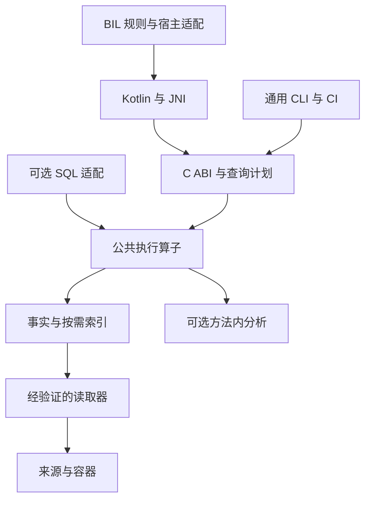

# DexMeguviz 完整工程计划

版本 1.0，2026-10-26。此文件是供开发 AI 持续查阅的工程基准，配套提示词负责启动，任务台账负责跟踪，证据文件负责说明完成程度。当前交付是可执行的设计与任务定义，尚无 DexMeguviz 实现或手机性能实测。

## 1 产品目标与完成标准

DexMeguviz 是项目中立的可嵌入 DEX 分析与查询 SDK。第一使用方为 BIL Android 适配，第二使用方为独立的桌面 APK 查询与声明/引用差分 CLI。两者共享解析、事实、执行和证据，不共享业务包名、Hook 规则和运行时对象。

基础 SDK 完成需要同时满足：标准输入可安全读取；语义和来源可解释；预算与取消可观察；两个使用方通过同一核心语义测试；已支持平台的 ABI/生命周期验证通过。BIL 生产替换另需完整 33 项规则、运行时绑定、业务缓存和真实设备验证；桌面速度不能代替这一门槛。

高级 SQL、增量、041、CFG 和数据流分别声明能力与成熟度。一个可选能力受阻，不阻止不依赖它的基础 SDK 进入验证。对外不得把整个计划表的能力都标成已支持。

### 1.1 三种运行配置

| 配置 | 目标 | 默认行为 |
| --- | --- | --- |
| EmbeddedLocate | 少量定位与移动端峰值 | 按需解码、少量线程、限制在途 DEX、完成后释放执行资源 |
| ResidentAnalysis | 多轮桌面查询 | 受预算控制的准备、复用 dataset 与已完成索引、有界游标 |
| CorpusBatch | 大量版本或文件 | 不可变事实分片、增量复用、确定性批处理、按需磁盘策略 |

三种配置不得改变 Exact/Contains、引用/定义、重复行、否定或唯一性的含义。配置选择是执行策略，不能成为隐藏的语义开关。

### 1.2 首版范围

| 能力 | 首轮目标 | 不满足时 |
| --- | --- | --- |
| 原始标准 DEX 035/037/038/039/040 | 稳定范围，逐版本夹具验收 | Corrupt 或 UnsupportedVersion 明确区分 |
| APK/ZIP 内 stored 与 deflate 多 DEX | 成熟 ZIP 后端，显式 source 集合和归档限制 | 不支持的压缩/加密/容器特征给 Unsupported，不当无匹配 |
| base APK 与 split | Android 适配器发现；核心接收有序来源集合 | 来源不完整影响 coverage，不能默认为无目标 |
| File/FD/owned buffer | 明确稳定性与所有权的输入 | 不稳定文件默认快照复制或拒绝该模式 |
| borrowed buffer | 明确 lease，内容不可变并能保持生命周期 | 不自动保存临时指针；可转 owning copy |
| DEX 041 | 第一日起兼容其身份模型，P4 单独实验解析 | 默认能力列表不宣称稳定 |
| 动态内存 DEX | 后续显式 provider，不读取私有 ART cookie | 能力缺失可见，静态 scope 不冒充完整运行时 scope |
| CDex/OAT/VDEX | 独立后续适配器 | 首版 UnsupportedFormat |
| 全量 Java 反编译、全程序污点、通用解壳、GPU/JIT 查询 | 首个稳定范围外 | 保留扩展边界，不生成空壳冒充实现 |

## 2 已固定决策与执行时核实事项

### 2.1 默认工程路线

C++20 原生内核、CMake、稳定 C ABI、Kotlin/JNI、可选 SQLite。优先标量正确实现，逐项 profile 后加入 SIMD 或第三方集合优化。详见 ADR-0001。首版不要求 C++ modules、协程运行库或完整编译器框架。

命名约定：项目 DexMeguviz；CLI `dexmeguviz`；C API `dmg_*`；头文件 `include/dexmeguviz/dexmeguviz.h`；Android 主 SO `libdexmeguviz.so`；内部 namespace `dexmeguviz`。暂定 Kotlin/Maven namespace `io.github.jichuo1.dexmeguviz`，创建远端或公开发布前验证命名归属。

BIL 固定快照使用 C++17 native target，Gradle 记录 NDK 30.0.16248370、CMake 4.1.2，现有 Android ABI 为 arm64-v8a/armeabi-v7a；CMake 文件自身最低要求是另一项约束，不能混为实际选用版本。执行时读取实际项目锁定值并记录差异，不能仅按本计划宣称当前环境已具备工具链。[B1][B5]

### 2.2 P0 需要实际确认

| 决策 | 默认选择 | 确认产物 |
| --- | --- | --- |
| 核心语言与构建 | C++20，target 局部设置 | host 与两种 Android ABI 的 smoke-build 记录 |
| Android SDK/minSdk/工具链 | 沿实际 BIL 兼容范围核实后固定 | 环境 manifest、Gradle version catalog 和依赖锁 |
| C++ runtime/依赖链接 | 单一 Android SO，隐藏内部符号 | BIL 打包与加载冲突试验、导出清单 |
| ZIP 与 DEFLATE 组件 | 选择可移植、可计账且许可合适的成熟组件 | 依赖 ADR、压缩/stored/ZIP64/损坏输入测试 |
| 强内容摘要 | 首版 SHA-256，明确输入字节与 domain separation | 摘要规范和固定测试向量；未来更换要改格式版本 |
| QueryIR 外部表达 | 版本化 JSON v1，编译为内部 typed DAG | JSON schema、规范化和跨前端语义测试 |
| 持久缓存 | P4 引入，前期可关闭 | 文件格式 ADR、损坏/版本/原子发布测试 |
| 性能有效差异 | P0 实测基线后预登记 | benchmark protocol，不在结果出来后修改门槛 |

JSON 仅作为计划输入与诊断/CLI 表达，不能因此要求每个指令或结果行都经 JSON/JNI 往返。固定规则在一轮执行前编译一次；内部执行使用整数 ID 和 typed data。

## 3 仓库与依赖结构

下面是待实现目录契约，不是本材料已经生成的代码树。

```text
DexMeguviz/
  CMakeLists.txt
  CMakePresets.json
  cmake/
  include/dexmeguviz/dexmeguviz.h
  src/source/       src/format/       src/facts/
  src/query/        src/planner/      src/execution/
  src/cache/        src/analysis/     src/c_api/
  adapters/sqlite/
  cli/
  bindings/android/
    settings.gradle.kts
    dexmeguviz-api/
    dexmeguviz-android/
    sample/
  integrations/bil/
  tests/fixtures/   tests/native/     tests/abi/
  tests/integration/                tests/sql/
  fuzz/            benchmarks/      tools/
  docs/contracts/  docs/decisions/   docs/evidence/
  docs/experience/ docs/templates/
  third_party/     LICENSE          THIRD_PARTY_NOTICES
```

该树仅表达工程目录，因此用文本路径列表；拓扑关系见下图。



| 模块 | 拥有的职责 | 依赖边界 |
| --- | --- | --- |
| source | source lease、范围、容器后端、摘要、输入预算 | 不调用 PackageManager 或 BIL 规则 |
| format | header/table/class_data/instruction/encoded value 的 checked reader | 不认识 Hook 或 SQL |
| facts | 定义、引用、callsite、string use、字段访问等 typed facts | 可按能力构建，不强制全部驻留 |
| query/planner | 语义验证、需求闭包、计划、成本、explain | 不把业务枚举编译进 switch |
| execution | 算子、Job、取消、批次、预算和状态 | 不替宿主决定永久负缓存 |
| cache | 内容分片、manifest、兼容与发布 | 不保存进程地址或 Java 对象 |
| analysis | 按候选方法 CFG/use-def/限定模型 | 输出假设和覆盖，不改变精确事实 |
| c_api/JNI | 句柄、所有权、错误翻译、批量交互 | 边界处理异常，JNI 不逐行回调 |
| integrations/bil | 33 项规则、角色验收、runtime profile | 依赖公共 SDK；核心不反向依赖它 |

core 首先作为静态 target 链入 CLI/JNI，避免过早拆成大量动态库。Android AAR 默认只包含移动端必要能力；桌面 SQL/MCP、高级分析按构建选项独立打开。自动生成绑定只生成机械接口与 schema，不生成无法解释的完整框架。

## 4 来源与身份契约

### 4.1 标识分层

| 类型 | 规范化组成 | 语义 |
| --- | --- | --- |
| ContentId | 摘要算法/域、内容长度和完整不可变字节摘要 | 相同字节；APK 包装与 DEX 内容分别标识 |
| ContainerId | 实际物理 DEX 容器 ContentId | 041 可含多个逻辑 DEX；不是外层 ZIP ID |
| LogicalDexId | ContainerId + logical header offset | 本地表编号的物理作用域 |
| StringPoolId | 容器中的池身份和格式定义 | 允许共享数据，不能只由文件名猜测 |
| SourceOccurrenceId | 输入清单的 namespace、稳定 slot key、角色和 ContentId，不包含 SnapshotId | 同字节出现两次仍保留两个出现位置，避免身份循环定义 |
| LocalRefId | LogicalDexId + table kind + index | 共享物理事实的本地引用 |
| ReferenceId | SourceOccurrenceId + LocalRefId | 某次出现中的引用 |
| DefinitionId | SourceOccurrenceId + LogicalDexId + 声明位置 | 一份定义，不等于 descriptor |
| CallSiteId | caller DefinitionId + dex_pc | dex_pc 单位固定为 16 位 code unit |
| SymbolKey | kind + owner/name/prototype 的无损规范表示 | 相同名字可能对应多份定义 |
| SnapshotId | 有序来源成员、namespace/解析策略、语义版本 | 本次查询宇宙与负依赖范围 |
| BindingKey | 进程 loader token + 可见来源代际 + SymbolKey | Android 层暂态标识 |

构造 SnapshotId 时明确顺序与 namespace，不能排序去重后丢掉加载语义。物理事实可按 ContentId 复用，出现级定义、解析、唯一性和运行时缓存须重新按 snapshot 判断。041 的摘要覆盖完整容器或经规范证明的全部依赖共享字节，不只覆盖单个逻辑 file_size。

### 4.2 来源协议

公开入口包括 `FileRange(fd, offset, length, stability)`、`OwnedBuffer`、`BorrowedBuffer(lease)`、`ArchiveEntry` 和显式 `SourceSet`。使用宽整数验证 offset/length；检查可读性、文件类型、输入字节、entry 数、声明解压大小和实际产出上限。

外部可变 FD 默认复制到拥有型 snapshot 或经允许的受控缓存文件。稳定安装包/私有不可变缓存可使用明确声明的 stable-source 映射路径。dup FD 只解决关闭所有权，不能冻结底层文件；映射被外部截断可能触发 SIGBUS，不能声称用 C++ try/catch 就解决。

复制只冻结实际取得的字节，不保证并发修改中的文件对应某一瞬间的完整 revision。需要精确版本时，使用冻结版本 FD、预期强摘要或能提供一致版本的来源协议；size/mtime 前后相同不是替代证明。无法建立精确 revision 的输入状态不能升级为来源已验真。

source lease 由 snapshot 和必要结果保持；输入稳定性、摘要验证和解析验证分别记录。借用来源无法维持异步生命周期时，在创建 Job 之前拒绝或复制。

### 4.3 容器与完整性

成熟 ZIP 后端负责中央目录、LFH、ZIP64、data descriptor、重复 entry 名和长度边界等。明确 classes.dex/classesN.dex 的枚举与排序规则，区分 APK code split 与不含代码的资源 split，重复名称不能静默选择第一项。

stored entry 可映射；deflate 解压到受预算约束的拥有型内存或调用方允许的文件。限制同时解压数量，实际输出超过限制即中止。大 entry 超预算不是“没有 DEX”。对常规 APK 之外输入按明确容器 profile 决定支持或拒绝，不擅自扩展为任意 ZIP 的全功能写入器。

分别记录 container metadata consistency、ZIP/DEX checksum policy、strong identity、结构安全。AOSP 不同 ZIP API 的 CRC 行为不同，不把成功返回等同所有校验已经完成。[A1][A2][A3]

## 5 Reader 与事实提取

### 5.1 验证层

| 状态 | 覆盖内容 | 可复用前提 |
| --- | --- | --- |
| ContainerChecked | 外层范围、容器元数据、输出长度 | 同一不可变来源与容器策略版本 |
| DexStructureChecked | header/map/表/variable item/关联约束 | 记录覆盖 section 与 verifier 版本 |
| InstructionStreamChecked | 指令宽度、payload、引用域和范围 | 明确到方法及解码能力版本 |
| ControlFlowChecked | 分支、异常边与合法目标边界 | CFG 范围、异常策略与解码版本 |

内容身份、checksum、业务匹配和 RuntimeBound 另行记录。不能用一个全局 validated=true 代表所有层。AOSP 文件 verifier 和复杂指令读取器有不同前提；复用其代码前在入口重新建立前提。[A4][A5]

### 5.2 必须处理的格式细节

所有 offset/count 在形成指针或 span 之前验证。优先使用 `offset <= size` 与 `count <= (size-offset)/element_size` 等不会自行溢出的检查，转换到 size_t/off_t 前验证可表示性。固定宽度读取采用 `load_le` 或 memcpy；范围成立不等于对齐与 C++ 对象模型成立。坏输入不以 DCHECK、assert 或 abort 处理。

- header、endian_tag、版本、map、段范围、表项大小及相互约束；v1 对 reverse-endian 输入可显式 Unsupported，不声明任意 endian 都稳定。
- ULEB/SLEB 的边界、位宽、允许编码策略、delta 累加溢出和索引上界。checked 解码不自动等同最短编码规范校验。
- MUTF-8 与 UTF-16 code unit 的关系，编码 NUL、补充字符、孤立代理项和非法输入策略。descriptor/member name 与任意字符串使用适合其规范的比较。
- class_data 中四组 delta 序列、flags、code_off、无代码的 abstract/native 方法，以及引用表有项但当前输入无定义的外部符号。
- 16 位 code units、变宽 opcode、switch/array payload、寄存器与索引、分支目标、try/catch 和有界 encoded_value 嵌套。
- invoke-custom 的 call_site 域、invoke-polymorphic 的 method/proto，保留引用种类，不挤成单个普通 callee。

利用原有有序 ID 表完成精确查找，class_data 一次 checked 遍历生成最小列式元数据；只对被需求闭包要求的方法解码。先有标量 decoder，再把同一次安全 walk 的事件分发给 string/invoke/field/numeric collector。采集器不逐指令创建复杂对象。[A6][A7]

### 5.3 事实的最低 schema

ClassDef、MethodDef、FieldDef、TypeRef、MethodRef、FieldRef、StringValue、StringUse、InvokeSite 是基础；numeric/field access/annotation 按阶段声明 capability。InvokeSite 至少保存 caller、dex_pc、opcode/invoke kind、target reference 与必要额外 proto/call_site 信息。

MethodDef 与 MethodRef 分表。无定义、无方法体、未解析、未分析和分析失败分别表达。反向索引由使用者确实请求时创建；同一 snapshot 已完整发布的索引复用。哈希和 Bloom filter 只作预筛，最终身份和谓词核对不能只比较 hash。

## 6 QueryIR 与执行算子

### 6.1 版本和字符串语义

QueryIR v1 是可规范化的 typed AST/DAG。最低内容为 schema version、required capabilities、source scope、relation root、谓词、关系算子、投影、排序、set/bag 语义、result intent 和 evidence profile。未知必需字段/能力返回 Unsupported，不能静默忽略。

DSL 的普通字符串在边界转换为明确的 UTF-16 code units；需无损表达孤立代理项等情况时，JSON 提供显式 `u16` 数组形式。Exact/Contains/Prefix 的默认域固定为 code units，RawBytes 比较另设操作；不执行隐式 Unicode 规范化。ASCII case folding 是独立模式。原始 MUTF-8 与展示 UTF-8 分列，展示相等不用于身份判断。

首版正则可暂不支持并返回能力错误；确需时选择确定语义和受控复杂度的成熟后端，明确其字符域。不要为了 API 看起来完整接入无预算回溯正则。

规范化保留有意义的 source 顺序、bag 重复和字符串语义；只有已证明可交换的纯逻辑组合才重排。IR hash 包含 schema、语义和 verification profile 版本。逻辑计划可跨 snapshot 复用；已解析 local ID、统计和索引引用属于 snapshot 绑定的物理计划。

### 6.2 最低操作集合

| 操作 | 首轮用途 | 必须明确 |
| --- | --- | --- |
| Scan/Filter/Project | 方法、类、字段和引用筛选 | source 范围、字段类型和未支持行为 |
| All/Any/Not | 字符串或结构条件组合 | 布尔语义；Not 的完整输入需求 |
| FlagsContains/FlagsExact | 修饰符要求 | raw DEX flags 与反射归一化 flags 的不同域 |
| SemiJoin/Join | 定义与 string use/invoke/owner 关联 | join key、bag/set 和外部引用 |
| Distinct/Union | 合并规则或来源候选 | 按哪个身份去重，不以名字误合并出现位置 |
| GroupByOwner | 同 owner 多方法与角色验收 | owner 唯一性与组内成员条件 |
| BoundedExpand | Story/Sponsor 等有限关系链 | 边类型、深度、访问预算和循环处理 |
| Exists/Unique/Enumerate/TopN | 明确结果意图 | 见覆盖与决策契约；限制不能替代唯一性 |

重复或重叠的多个 invoke 条件需要先确定“同一 callsite/target 能否满足多个谓词”。已审计 DexKit 的多 matcher 有其匹配覆盖语义；BIL 中目标互异的具体规则可以证明等价后编译为 AND，不能把这个结论推广到任意 DSL 兼容。[D1][D2]

同一 flags 域内，FlagsContains(value, required) 为 `(value & required) == required`，FlagsExact 为完整值相等；任意位命中如需要则另设 FlagsAny。raw/反射域的归一化使用版本化显式映射，不默默删除额外位；引用没有定义而属性不可得时，不以零替代。

### 6.3 计划优化次序

先验证 query/type/capability，再收窄来源、owner、签名和参数；随后使用现有 ID 索引或候选方法读取字符串/引用；最后物化 descriptor、证据与外部对象。纯元数据查询不启动指令解码器。

同一批 roots 可共享元数据、选择集与已请求的事实。共享子条件必须包含 source、语义和 profile 身份，不能错误复用不同域的否定或绑定判断。成本模型首版采用可解释规则和已知计数，不引入难以验证的机器学习规划器。

候选容器先使用有序小数组与普通 bitset；达到真实规模热点后再评估 Roaring、TypeLookupTable 风格布局和稀疏 offset 编码。冷/热分开记录构建和保留成本。不存在脱离工作负载的“所有查询预建索引总会更快”。

### 6.4 explain 与 profile 契约

至少输出：query/plan/snapshot ID；source scope；required/built/reused capabilities；各算子输入输出行数；选择的索引及理由；下推/剩余过滤；读取、解压、code-unit 和方法访问量；索引构建次数；受控内存峰值；取消检查点；结果意图、coverage 和提前结束原因。

`explain` 不应为解释计划偷偷完成全量扫描；缺少统计时标估计。`profile` 才记录真实执行。用户可见 CLI 保留简洁默认输出，完整诊断通过显式选项或 JSON 取得。

## 7 结果完整性与证据

### 7.1 两条独立状态轴

执行/覆盖轴采用 Complete、Partial、Cancelled、BudgetExceeded、Unsupported、CorruptInput、SourceChanged、InternalError 等明确状态；决策轴采用 ProvenTrue、ProvenFalse、Undetermined 或适合结果意图的枚举。执行 API 的“调用成功”与 query 终态不可混为一谈。

实现时将 Job 生命周期 Queued/Running/Completed/Cancelled/Failed、coverage manifest 和 decision 分字段保存，错误原因另有稳定枚举。正常完成 Exists 可以具有局部 coverage 和 ProvenTrue；Completed 不能自动翻译为扫描全部来源。

| 意图 | 正确早停 | 完整范围要求 |
| --- | --- | --- |
| Exists | 一个被要求的验证层接受的 witness | 返回 false 时完成相关范围 |
| Unique | 两个身份不同且满足同一验收条件的候选可证明 false | 返回 true 时完成其余相关范围 |
| Enumerate | 可以流式返回可靠子集 | 声称列表/计数完整需要完成范围 |
| TopN | 有序索引或对未访问范围的有效界限 | 不能仅排序已扫描子集后声称全局前 N |

若 native 仅完成静态匹配，而业务唯一性还要经过 Android verifier，native 不替它证明最终唯一。将候选与静态 coverage 交给项目验收器；业务接受层有自己的完整性要求。

Unique 定义为按声明身份去重并通过所需验收后恰好一个候选：完整零候选为 ProvenFalse/NoMatch；完整一个为 ProvenTrue；至少两个为 ProvenFalse/Ambiguous；范围未完成且只有零或一个时为 Undetermined。去重实体可以是 definition、owner 或项目角色组，必须由 query/profile 指定。

### 7.2 证据类型

MetadataWitness 使用声明/表项/属性位置；InstructionWitness 使用方法、dex_pc、opcode 和所需字节范围；RelationWitness 保留端点与连接原因；CoverageManifest 保存完整来源/分片和完成状态。证据包含 source digest、snapshot、规则/解析器/验证器版本及模型假设。

独立验证器至少独立读取相关原始字节，不直接相信主引擎生成的候选/缓存。若复用相同 decoder，只能称为共享组件的复核，不宣称完全独立。正命中可局部验证；唯一性/不存在需要重查完整相关范围或经独立验证的覆盖索引。哈希不证明搜索没有遗漏。

### 7.3 高级分析

CFG 在已验证指令边界上构建，覆盖规定异常流；结构路径不证明路径条件可满足。局部 use-def/常量传播有明确 lattice、溢出与未知调用策略。先服务候选方法，避免默认全程序分析。

结构相似搜索只返回候选及解释，不把分数当概率或已验证身份。框架模型外置、版本化，声明适用条件。CHA/RTA 如后续加入，输出 scope/entry point/动态加载假设，保持近似边与精确 callsite 分开。

## 8 C ABI 与生命周期

### 8.1 接口形状

以下是 ABI 设计约束与函数族，不是已经实现的头文件。P0 固化原型，P1 提供实际头文件和 C 消费者测试。

| 函数族 | 责任 |
| --- | --- |
| dmg_engine_create / retain / release | 创建调度与资源账本，明确关闭语义 |
| dmg_capabilities / dmg_versions | 查询 ABI、IR、格式与分析能力 |
| dmg_snapshot_open / retain / close / release | 保持源所有权，禁止关闭后新任务 |
| dmg_query_compile / retain / release | 验证外部 IR，得到不可变逻辑计划 |
| dmg_job_start / retain / next / cancel / status / release | 单次执行、共享持有、批次读取和可观察终态 |
| dmg_batch_retain / release / accessors | 批次所有权、长度及 typed columns |
| dmg_error_* / dmg_profile_* | 明确持有周期的诊断和统计 |

选项结构含 `struct_size` 和版本，使用固定宽度类型及明确布尔/enum 表达，不把 `long` 或 C++ enum 布局作为跨平台磁盘格式。为旧调用者新增字段要有默认语义。错误字符串、返回 buffer、回调和分配必须明确释放者。

C ABI 边界处理 C++ 异常；低层无法恢复的进程错误不能伪称可由错误码处理。不得跨边界抛异常、传 STL、Java 对象或 Rust 内部对象。API 句柄错误策略需要写清，不能把任意损坏指针检查宣传成通用内存安全。

### 8.2 线程与关闭

Engine 与 Snapshot 可共享只读使用；同一 Job 的 next 是单消费者，cancel/status 可跨线程，调用者在调用期间持有有效引用。close(snapshot) 拒绝新 Job；已有 Job 由引用保持运行，或通过明确 close-and-cancel 选项取消。

Engine shutdown 先关闭 admission，再按明确的 drain/cancel 策略处理已接受任务；release 只释放当前引用。Job 终态仅提交一次，之后 outcome 不变。暂时无批次为 NotReady；只有 Job 已终态且内部队列排空才是 EndOfStream，最终失败状态仍须查询并传播，不能只把 EOF 当成功。

Batch 持有其数据所有者或独立数据；Job 销毁后依然有效的批次必须有独立引用。短期 borrow API 单独命名，并注明 next、close、release 的失效点。JNI 默认转成可持有值对象或受 AutoCloseable 管理的批次，不能保存未固定的临时数组地址。

不在内部锁下调用外部回调；避免全局 mutable singleton。依赖使用全局 allocator hook 时先确定隔离和计账方案，不修改宿主进程中共享库的全局状态来实现自己的预算。

Job 终态或释放后，外部仍持有的 Batch、backing storage 和必要 owner 继续占用结果/引擎预算，资源账本也保持有效，直到最后持有者释放。共享索引只计一次；慢消费者通过有界队列、保留预算和背压控制，不能靠无限缓存维持生产速度。

### 8.3 取消与预算

明确 Job deadline 与 wait timeout：后者只停止等待。reader/decoder、分段解压、集合运算、关系扩展和物化设置检查点，记录最大无检查工作块与真实取消延迟分布；不承诺任意硬件上的硬实时毫秒上限。

v1 可用每 4096 code units、1024 集合元素或 64 KiB 顺序输入/输出工作量作为初始检查量子，按当前算子先达到的相关上限检查。大字符串、摘要和嵌套 worklist 内部同样设检查点。这些是待校准的工作上限，不是已测延迟承诺；每个算子在 profile 中声明实际适用量子。

whole-buffer 第三方调用可能只能在前后检查取消。应限制其最大工作块、记录不可中断范围；如需进程级强制中断，作为可选隔离配置，连同 dataset 丢失和重建成本一起说明。

预算分为 owned bytes、index bytes、scratch bytes、result/cursor bytes、mapped address space 等账目，声明哪些依赖分配已覆盖。RSS/PSS 单独观测，不能由 malloc budget 推导。预算检查使用有界/失败安全的计数，不发生加法溢出。超预算不自动切换到更高内存后端。

## 9 缓存 增量与预解算

| 层 | 内容 | 失效依据 |
| --- | --- | --- |
| L0 | 项目最终目标与角色、接受状态 | 来源集合、规则、验真和绑定条件 |
| L1 | 通用事实分片 | 物理内容、parser/语义版本、覆盖能力 |
| L2 | 字符串和关系等可选索引 | 对应事实、索引格式和完整性 |
| L3 | 会话/游标/临时状态 | snapshot、计划、顺序与会话租约 |

共享构建完成后才原子发布；持久 manifest 必须与分片配套提交，进程死亡不留下“完整”假条目。并发构建协调是后续优化，首版允许只共享完成索引并串行构建。

缓存键包含 strong identity 与版本域。APK 资源或压缩方式变化而 DEX 相同，可复用物理事实；Snapshot 与 occurrence 仍核对。负依赖保存未命中的完整搜索分片；新增 split、来源顺序、namespace、库或模型变化会影响唯一性和解析。

磁盘格式使用固定 endian、位宽、相对 offset、section table、长度上限、能力/版本及校验。先验证格式再映射访问；损坏缓存可局部删除重建。禁止直接落盘 STL、指针、Java/loader token。缓存写入采用临时文件和原子替换策略，明确同进程/跨进程锁、文件权限、配额与清理；缓存只是加速，损坏不改变语义。

预解算包包含精确来源摘要、规则/profile 版本、descriptor、角色和证据。命中后仍做身份、局部证据和运行时验真；不伪造“完全零 I/O”。摘要确认可以与必要读取融合，但计算成本仍计时。离线包的发行认证与内容一致性是不同契约，未定义可信分发前不自动执行包中的代码。

## 10 Android 与 BIL 接入契约

### 10.1 通用 Android 层

`dexmeguviz-api` 提供查询和值类型；`dexmeguviz-android` 提供来源适配、JNI 生命周期和可选 binder。核心不需要 Android SDK。JNI 用可管理句柄、局部引用边界和批量结果，禁止在长扫描中误用 FastNative/CriticalNative；Java exception 与 native error 双向翻译明确。[N1]

Android 适配器发现 base/split APK，记录可见来源、ClassLoader 及代际。静态来源集合不自动覆盖之后动态加载的 DEX。公共 binder 默认采用不主动初始化目标类的方式取得元数据；BIL 专属 verification profile 可显式保留其已有构造/单例验真，并记录副作用与调用线程。

绑定结果至少携带 declared owner、实际 defining loader、签名验证、OriginVerified/OriginUnverified 及失败类型。BindingKey 不能仅由 descriptor 或 identityHashCode 持久化生成。可见来源扩展后，失败/未找到缓存需重新评估；已经绑定且依然有效的类按其实际语义保留。

### 10.2 BIL façade 与状态转换

通过现有 `DexAssistEngine.resolve/resolveAll` 接入 `DexMeguvizAssistEngine`。Native 返回定义、类、角色与 witness，BIL 层再构造 Method/Class/relatedClasses。保留批次 session 复用；计划外查询若补查，显式记录额外准备成本。[B1][B2][B3]

不能把原有 `Unavailable.Reason` 的有限枚举当新内核所有状态的唯一容器。先引入详细内部 outcome，最外层兼容映射要同时保留诊断和重试/负缓存策略；必要时小范围扩展 BIL 内部接口并添加行为测试。

| 新内核情况 | 宿主处理要求 |
| --- | --- |
| Complete 且业务验证后无候选 | 可按明确 scope/规则版本写“已完成无匹配”缓存 |
| 静态有候选、绑定或业务验真失败 | 记录具体失败，不混成解析器无匹配 |
| 两个接受候选或角色关系歧义 | 返回歧义，不随机取第一项 |
| Cancelled/Deadline/BudgetExceeded | 本次未完成；由版本化恢复策略决定重试，不写完整否定缓存 |
| CorruptInput/SourceChanged/不可读来源 | 记录来源和 coverage 缺口，避免持续重试同坏输入 |
| Unsupported capability/version | 兼容性状态，不能静默忽略谓词 |
| Native unavailable | 明确加载/ABI错误；自动旧后端回退必须是显式配置并记录预算后果 |

### 10.3 热缓存与恢复

完整业务缓存命中时，保持现有零扫描主路径，不增加全量强摘要、编译 query 或扫描 SO 加载。需重建适配时才进入来源确认与引擎流程。[B3]

昂贵摘要/解压前先写基于轻量来源清单、规则和引擎版本的 admission marker；强身份得到后关联本次 execution。轻量指纹不证明内容相同，旧 marker 有受控复核和手动 reset，防止既重复触发同一失败又永久抑制已变化来源。原生后台线程仍位于宿主进程，不能宣称其提供内存隔离。[B4]

先在测试配置提供后端选择和影子对照。影子运行只用于正确性测量，不成为生产默认。生产切换通过 P5 决策；移除 DexKit 的生产依赖、native 打包和混淆规则同时核查，测试对照可另保留。不要将最终删除依赖提前作为第一步。

### 10.4 BIL 的非纯静态验真

现有部分验真会读取 canonical static key 并调用其字符串展示；倍速模型验真会调用构造器并读取字段。保留为明确的 BIL profile，并测试类初始化、异常、线程、次数与对象生命周期。通用内核继续只读取字节；不能因希望“完全无副作用”而删掉现有验证，也不能把这些业务行为引入所有使用方。

完整 33 项的逐条映射在本计划附录 A；执行时逐项对应源码、QuerySpec、静态结果形态和 runtime verifier。

## 11 桌面 CLI 与 SQLite 路线

### 11.1 CLI 最小命令契约

| 待实现命令 | 输入与输出 |
| --- | --- |
| `dexmeguviz inspect INPUT --json` | 来源与 DEX 版本、定义/引用统计、能力和错误；统计注明范围完整性 |
| `dexmeguviz query INPUT --query FILE --json` | QueryIR、候选、证据、coverage/decision 和终态 |
| `dexmeguviz diff OLD NEW --json` | 声明/引用变化；同名多定义与来源变化不被抹平 |
| `dexmeguviz verify INPUT --evidence FILE --json` | 独立验证路径与其覆盖范围，不自动宣称证明唯一性 |
| `dexmeguviz sql INPUT --sql-file FILE --json` | 可选 SQLite 查询；严格提交或显式 provisional 协议 |
| `dexmeguviz explain INPUT --query FILE` | 不强制全量扫描的逻辑/物理计划说明 |

首版核心 CLI 先提供 inspect/query，后续按任务补其余命令。标准输出 JSON 有 schema_version 和最终状态，诊断到 stderr；退出码区分成功、输入/能力错误、资源/取消与内部错误，具体数字在 CLI contract 固定。接续工具不能只依据退出码忽略结果覆盖。

CI 差分示例必须使用非 BIL 合成或许可清楚的公开语料，在无 Android SDK 的环境运行。它比较 SymbolKey 与出现级定义/引用；结构对应关系是额外结果，不能把改名方法当同一稳定 ID。

### 11.2 SQLite v1 catalog

先冻结 read-only 的 sources、logical_dex、classes、method_defs、field_defs、method_refs、field_refs、string_values、string_uses、invoke_sites。文档明确每表一行的粒度、复合 ID、NULL、缺失定义和 unsupported feature。raw MUTF-8 可用 BLOB，展示文本与明确 DEX 比较函数分开。

首版以普通 SQLite 语义为准，不宣称 DexSQL drop-in 兼容。若要比较 DexSQL，建立明确转换表：其 LIKE/ESCAPE、UTF 排序、引用/定义和 callsite 范围逐项核对。[S1][X1][X2]

### 11.3 虚表实施次序

1. 保守扫描可用，默认不设置 omit、不宣称 orderByConsumed、不下推 LIMIT。
2. xBestIndex 读取可用约束和 colUsed，返回访问方案、估计行数与成本；实际值在 xFilter 绑定。规划回调可能多次发生，不在每次规划时解压或建大索引。
3. 只对已证明等价的约束下推。Bloom/prefix 粗筛保留精确 residual，collation 不确定时保留 SQLite 检查。
4. 用官方 all-at-once IN 接口批量处理适用集合；不支持时正确逐值回退，不能改动 NULL 或多重集语义。
5. 有真实有序索引或等价执行路径才声明消费排序。LIMIT/OFFSET 只在剩余过滤、连接和排序之后仍等价时下推。[S1][S2][S3]

### 11.4 严格结果提交

SQLite 在语句最终成功前可能已经返回部分行。默认 wrapper 在结果预算内暂存，语句成功完成才发布完整结果；超预算可采用调用方明确允许的桌面 spool，或返回 BudgetExceeded。不得无界累积结果。

流式模式须把批次标成 provisional，并在最终成功时发送 complete 标记；后续失败不能吞掉终态。客户端区分完整执行后展示截断与执行未完成。COUNT、NOT EXISTS、反连接和全局 TopN 不能把未完成输入当完整关系。

合法 SQL EXISTS/LIMIT 的早停不要求扫描无关范围；其结果必须能在声明语义下成立。需要探索不完整输入时提供独立 coverage API，或由调用者显式选择一个较小但完整的 scope。

### 11.5 驻留与 MCP

dataset/snapshot 不可变；普通查询取消释放其不再被有效结果持有的临时状态，不删除完整共享索引。游标绑定 snapshot、计划、排序和保留预算，过期/关闭明确报错。重执行分页如被使用，要有稳定唯一排序并计入重复执行成本。

MCP 作为后续可选包装，提供有界重任务队列、输入/输出配额和最终提交状态。排队取消、运行取消、工作进程终止分别定义，不把结果条数限制当成内存或 CPU 上限。[X3][X4]

## 12 测试与独立验证矩阵

### 12.1 语料分层

每个 fixture 有稳定 ID、生成方法、字节摘要、期望事实/状态、许可与 oracle 来源。使用独立工具生成正常 DEX、受控字节变异生成错误 DEX；人工确认小 fixture 的语义。不能把被测实现首次输出直接保存成唯一 golden。

实际 BIL 语料从项目历史宿主记录建立索引，取得精确 APK 后再确认。现有 36 个历史记录并不等于本次已拥有和重跑 36 个 APK，当前 9.17 构建也单独纳入。私有 APK 不自动上传到公开 CI；保存可分享的摘要和最小合成复现。[B9]

### 12.2 原生输入与生命周期

| ID | 样本/操作 | 必须断言 |
| --- | --- | --- |
| F01 | 五种稳定 DEX 版本、stored/deflate/raw/multidex | 版本、源边界与基础事实一致 |
| F02 | header/map 截断、段越界、宽度乘加溢出 | 在访问之前拒绝，状态非无匹配 |
| F03 | ULEB/SLEB 边界、delta 溢出、非法索引 | 合法 profile 与损坏明确区分 |
| F04 | NUL、代理对/孤立代理项、ASCII/非ASCII、非法 MUTF-8 | 编码策略和无损身份一致 |
| F05 | 无 body 的定义、外部引用、同名多定义 | 三类不互相冒充 |
| F06 | 变宽 opcode、payload、jumbo、range、custom/polymorphic | 正确推进 PC，引用域和错误位置准确 |
| F07 | try/catch、分支进 payload/中间位置、嵌套值 | 已声明验证层的目标与深度约束成立 |
| F08 | ZIP 重复名、ZIP64/descriptor、长度不符、解压超限 | 明确 profile，实际输出受限，不绕过预算 |
| F09 | 可变 FD、调用方释放原引用但有效 lease 仍由核心持有、snapshot close | 合法生命周期无悬空；无有效 lease 时拒绝提交；不保证调用方违规改写/释放裸内存后的安全 |
| F10 | 分配故障、取消、并发 close、retain Batch 后释放 Job | 无伪成功/泄漏；Batch 仍计预算，最后释放后回收 |
| F11 | 同时构建/读取索引，一个等待者取消 | 不发布半成品，不释放别人仍持有数据 |
| F12 | 损坏/旧版/未知段缓存、写入中进程结束 | 可拒绝或恢复，不把坏缓存变成指针表 |

采用 ASan/UBSan 和覆盖引导 fuzz 等实际可用工具，记录 compiler/profile/time/seed 与发现的最小失败样本。sanitizer 通过不等于无错误证明。并发测试应设计可重复调度或故障点，不只随机跑很久。

### 12.3 查询行为

| ID | 样本/查询 | 必须断言 |
| --- | --- | --- |
| Q01 | 不同 DEX 相同 local method_idx | 不发生跨域误联接 |
| Q02 | 同 descriptor 多定义、同字节重复 source occurrence | 名字可相同，定义出现身份和唯一性正确 |
| Q03 | 字符串只在注解/静态值，或被方法 const-string 使用 | usingStrings 证据域不混淆 |
| Q04 | 一个字符串匹配多个模式、多个方法各满足一部分 | All/Any、作用域和 distinct 语义明确 |
| Q05 | flags 额外位、仅部分required位、raw/反射域、未知属性 | Contains不是Any或Exact；未知不变零，域归一化受测 |
| Q06 | 同目标两个 callsite、重载、外部调用 | 保留 callsite 数和完整符号 |
| Q07 | 跨 DEX 两跳且中间定义歧义 | 按显式解析策略输出证据与歧义 |
| Q08 | 声明字段与方法读写字段，继承与自身声明 | 不把三种范围混为一谈 |
| Q09 | 完整零/一个候选、一个后中断、两个后中断 | Unique为恰好一个；decision/coverage正确，NoMatch与Ambiguous分开 |
| Q10 | 前 32 个 raw 候选被业务拒绝，第 33 个才接受 | raw cap 不产生错误无匹配或唯一结果 |
| Q11 | 后分片有更优排序键或同键 | 全局 TopN 与稳定 tie-breaker 正确 |
| Q12 | 相似规则但 scope/文本模式/profile 不同 | 仅等价子工作共享，批量与单独结果一致 |

### 12.4 SQLite 下推

用同版本普通 SQLite 表物化人工确认的小事实 fixture 作为 SQL oracle；按查询比较有序序列或多重集，不统一 sort+dedup 掩盖重复行。

| ID | 查询形状 | 必须断言 |
| --- | --- | --- |
| S01 | IN 重复值、NULL、空集和运行时子查询 | RHS 重复不复制表行，SQL 三值逻辑正确 |
| S02 | JOIN 次序导致约束不可用 | 只用 usable 约束，不生成错误空扫描 |
| S03 | self join、one-to-many、UNION ALL、COUNT DISTINCT | bag 乘法与去重时机一致 |
| S04 | LEFT JOIN 与 WHERE、未定义引用的 NULL 属性 | 不把外连接变内连接，不用 0 替代未知 |
| S05 | LIKE/ESCAPE、NUL、collation、非ASCII | SQLite profile 与显式 DEX 扩展分别正确 |
| S06 | 多列 ASC/DESC、NULL 排序、跨分片 TopN | orderByConsumed 只在真实满足时设置 |
| S07 | LIMIT/OFFSET 加 residual、JOIN、DISTINCT | 不在剩余条件之前错误截断 |
| S08 | 粗筛后精确比较、只取 ID 与 SELECT * | omit 与 colUsed 使用正确，投影可观测 |
| S09 | 复合唯一 key 与仅 descriptor | 不错误声明 unique access |
| S10 | 已产生行后出错、超预算、取消 | 终态失败，wrapper 不提交完整结果 |
| S11 | 游标到期、snapshot/plan 变化 | 不混页，不把失效变成到达末尾 |

### 12.5 Android 与 BIL

逐条完成附录 A 的静态与 runtime 验真；专门测试构造器/clinit 转 Class、同 owner 多方法、relatedClasses、业务副作用、类型加载失败、同名不同 loader、规则未计划补查、marker 恢复和完整业务缓存命中。

包括 arm64-v8a/armeabi-v7a 的构建与真实运行；4 KB/16 KB 设备/模拟器条件按可取得范围记录。只完成 host 测试时，Android 项目状态仍为未验证。[N2]

## 13 性能协议与决策门槛

### 13.1 比较对象

A 为固定 BIL + DexKit 2.3.0 的真实当前用法，不能人为改成每条规则重新建 bridge；B 为相同语义与输入下优化计划、生命周期和物化后的 DexKit；C 为 DexMeguviz。另设桌面 D 对照为固定版本 DexSQL，只比较语义对齐的子集，不把其 desktop session 倍数代入手机。[D3][X5]

同时报告 A→B、A→C、B→C。A/B 只提供描述符或绑定结果而不提供 PC 时，在共同投影上比较产品结果；额外 PC/来源若由独立工具派生则标注来源，不能伪造后端原生证据。C 自身仍需通过完整事实 golden。

### 13.2 预登记文件

`benchmarks/protocol.v1.json` 在正式 C 性能结果出现前固定：源码/build/工具链；APK 与规则摘要；验证器；功能开关；设备/系统/ABI/页大小；线程与预算；前台脚本；电量温度；冷暖模式；run-order seed；样本数；排除规则；timer 范围；统计方法；最小有效差异；停止和重跑规则。

冷暖至少区分：完整项目缓存命中、结果缓存 miss 且 native 未打开、已打开 snapshot 的 warm query、持久事实缓存命中。操作系统页缓存状态另列；强停 App 不等于冷盘。原生库加载、强身份、解析、业务验真、结果转换和必要持久化都在完整适配计时包络内，不只为 C 移出计时。

手机每配置可从 20–30 次交错成对样本开始估计中位数及区间；p95/p99 需要足够尾部样本与预定方法，否则写未验证。失败样本完整保留；正确性失败不能作为成功性能样本，但失败率也不能被删掉不报告。比较组条件改变后重新跑受影响范围。

### 13.3 指标与初始门槛

| Gate | 初始要求 | 决策含义 |
| --- | --- | --- |
| Correctness | 所支持范围的预期身份、关系、状态与验证通过 | 任何关键语义失败阻止对应能力切换 |
| Product A→C | DEX 占比允许时，完整未缓存适配 p50 下降25%、扫描增量峰值下降30%为探索目标 | 不是预测保证，P0 根据分母确认 |
| Net B→C | 建议预登记候选为完整耗时净降15%，或固定主内存指标净降25%并满足资源目标 | 正式阈值由 P0 在看 C 结果前确认；资源路线还需限定时间回归 |
| Warm | L0 完整命中无扫描/索引构建，无可重复有意义回归 | 预先定义绝对容差，不把极小噪声当胜负 |
| Foreground/tail | 在固定脚本下不超出预登记前台和尾延迟回归范围 | 未测不算通过；不能用后台均值替代 |
| Reuse | BIL 与无 Android 的 CLI/CI 都通过相同事实语义测试 | 满足可复用 SDK 定位 |
| Lifecycle/resource | 持有/释放/取消契约通过，预算覆盖声明准确 | owned budget 与 RSS/PSS 分开报告 |

这里的 15%/25% 是新内核维护价值的初始门槛建议，不是现有测量结果。实际取值、主指标和区间方法由 P0 预登记；不可在正式 C 结果出来后挑更漂亮的指标或降低门槛。

研究中的阶段速度 1.5–2.5 倍和扫描增量峰值下降30%–60%只相对 A。阶段占比 f、阶段提速 s 时，整轮新旧时间比为 `1-f+f/s`；若 f=70%，对应整轮下降23.3%–42%。完整缓存命中本来不扫描，直接扫描收益为0。

解压、SIMD、索引、融合和 PGO 的改善包含在总结果内，不相加重复计功。至少对关键优化做单项消融，解释 bytes touched、decoded units、builds 和分配量的变化；没有热点证据就暂缓增加优化依赖。

### 13.4 缺少设备时的状态

可完成 host 基准及合成 fixture，但 BIL 手机耗时、RSS/PSS、ARM 热状态和 LSPosed 生效仍未验证。只在桌面驻留查询改善时，可批准桌面用途；BIL 生产替换维持原后端直至相应门槛通过。

## 14 分阶段交付与任务依赖

按 2–3 名相关经验工程师全职投入、语料与设备可及时取得估算：4–6周验证关键原型，约8–12周形成双使用方最小版本，第19–24周争取完成稳定 SDK 与桌面版本验证。时间是排期估计，验收以实际证据为准。

| 阶段 | 时间窗口 | 阶段产物 | 主要门槛 |
| --- | --- | --- | --- |
| P0 | 第1–2周 | 环境、构建、契约、语料、规则清单、基线协议 | 能在实际工具链构建最小产物，任务与语义可核对 |
| P1 | 第3–6周 | reader、decoder、facts、最小 QueryIR、C ABI、CLI | 端到端纵向切片正确；代表性规则子集测完整成本 |
| P2 | 第7–10周 | 优化计划、Kotlin/JNI、BIL33、第二使用方 | 生命周期与业务语义通过，开始完整规则设备对照 |
| P3 | 第11–14周 | SQLite、驻留、profile、受控结果协议 | SQL 语义正确，prepare/first/warm成本分开 |
| P4 | 第15–18周 | 缓存、增量、预解算、候选分析、实验041 | 负依赖与证据完整；实验能力独立准入 |
| P5 | 第19–24周 | 兼容、压力、完整基准、候选发布、迁移 | 资源、语义、净价值与支持矩阵共同通过 |

具体任务以 `backlog.json` 为准，附录 B 提供同一台账的可读索引。前置是工作依赖，不要求整个前一阶段全部完成才开始；例如设备基线受阻时，可继续 reader/CLI/SQL。生产切换只依赖自己完整的必需验证，不被未启用的实验041/CFG阻塞。

P1 的性能门槛只用于选定规则子集，不提前宣称33项完整替换通过。若实测相对优化 DexKit 无净价值，保留公共接口、缓存控制和第二使用方成果，记录瓶颈与失败方案，再决定内核进一步投入。没有测量条件时结论是未验证，而非胜出或失败。

## 15 构建 CI 和复现命令契约

下列 DexMeguviz 命令是待创建的接口。P0 必须先提供对应 CMake presets、Gradle wrapper、脚本与 fixtures；不能在命令尚不存在时报告已运行。选择并锁定真实依赖版本，不把下载失败或环境缺失伪装成测试通过。

### 15.1 Host 入口

```bash
cmake --preset host-debug
cmake --build --preset host-debug
ctest --preset host-debug --output-on-failure
cmake --preset host-asan
cmake --build --preset host-asan
ctest --preset host-asan --output-on-failure
```

预设固定输出目录，例如 `build/host-debug`，使 CLI 复现命令具有稳定路径。Release 与性能构建另设 preset，禁止把 sanitizer/debug 成绩与另一组 release 成绩比较。

```bash
build/host-debug/dexmeguviz inspect tests/fixtures/generated/minimal.dex --json
build/host-debug/dexmeguviz query tests/fixtures/generated/minimal.dex --query tests/fixtures/queries/string_exact.json --json
```

这里的样例文件由 P0/P1 fixture 任务生成，并有独立 expected 数据。脚本运行前验证存在和摘要，不用空文件或随便一个 APK 代替。

### 15.2 Android 入口

在 `bindings/android` 创建并锁定 Gradle wrapper 与三个模块后，提供：

```bash
./gradlew :dexmeguviz-api:test :dexmeguviz-android:assembleDebug
./gradlew :dexmeguviz-android:connectedDebugAndroidTest
```

第二条需要实际设备，至少验证一组真实执行的测试数量和报告，不把无设备/无样本 skip 当通过。生产支持两个 ARM ABI；模拟器用测试 flavor 的额外 ABI 不自动进入生产 AAR。

### 15.3 BIL 已有入口的复用

在完整 BIL checkout 的实际 Gradle 根目录，先核对任务再运行相关范围：

```bash
./gradlew :app:testDebugUnitTest -PinnocentLab.testLayer=unit
./gradlew :app:testDebugUnitTest -PinnocentLab.testLayer=contract
./gradlew :app:contractsFor -PinnocentLab.contractTarget=DexKitAssistEngine.kt
```

`contractsFor` 用于找影响面，不等于执行测试。接入新后端后更新 backend-specific 的源码文本测试为 QuerySpec/结果契约测试，保留业务行为测试。原有设备 runner 无 APK 参数可 skip，且多为单 APK，需要参数化 A/B/C 并新增 base+split 的明确 source manifest。[B10]

### 15.4 CI 层次

| 层 | 每次相关变更 | 额外/发布门槛 |
| --- | --- | --- |
| 文档/schema | 任务 ID/DAG、schema、规则清单和引用检查 | ABI/格式变更须 ADR |
| Native | 有关单元与fixture、C消费者ABI smoke | sanitizer/fuzz回归与跨平台构建 |
| Query/SQL | 标量对照、残余/排序/bag/NULL差分 | 完整语义矩阵与性能消融 |
| Android | Kotlin/JNI合约、AAR内容与两个ABI构建 | 真机生命周期、页大小与宿主runner |
| BIL | 相关规则/状态/reducer测试 | 完整33项、真实来源/绑定及指定LSPosed端到端 |
| Release | 许可证、依赖锁、导出符号、文档 | 完整指标、回滚演练与支持矩阵 |

只为具体风险或必需门槛扩大验证，不反复运行与当前变更无关的大套测试。规则、版本、字节码、ABI、格式和并发变化需要对应的行为验证；拼写等低影响文档改动只检查引用与结构。

## 16 AI 协作与长期记录

### 16.1 任务状态

`backlog.json` 允许 planned、ready、in_progress、implemented_unverified、blocked、done、deferred。done 必须满足该任务全部必需验收；缺少环境但代码完成使用 implemented_unverified，并写受影响条件。deferred 需要理由、范围和不影响哪个发布 profile。

状态台账是唯一权威，工程计划中的任务表是初始可读视图；实现过程中动态完成状态不要同时在两处手工维护。`PROJECT_STATUS.json` 保存当前 focus、下一任务和证据索引。实际 git 仓库与状态初始为 null，不能因本材料生成而自动填写虚构 commit。

### 16.2 并行分工

建议三个实现方向与一个审查角色按可用并发资源分配：reader/ABI；query/SQL；Android/BIL；独立验证/性能。先由主代理冻结共用 schema，再分文件所有权。没有足够并发时顺序执行，不因此减少验收。

每个子任务交付路径、接口、实际命令、未完成范围与下一依赖；主代理核对关键代码、合并共享状态并处理冲突。接口变化不能只在聊天中通知后留下文档不一致。

### 16.3 经验与接续

重要经验完整记录现象、证据、根因、最终方案、失败方案、验证范围。ADR 记录可复用接口、输入策略、语言、依赖、格式或阶段目标变化。未验证推断标明状态，超时和重复跑更久不构成正确性证明或独立性能贡献。

一轮结束留下：已改代码与当前 commit；完成任务；实际测试/基准；失败样本；环境缺口；尚未满足的 release gate；下一条可执行命令或任务。后续 AI 读取这些继续，避免重新扫描所有资料或重新规划已经确定的接口。

## 17 风险处置与发布候选

| 风险/触发 | 处置 | 可继续的工作 |
| --- | --- | --- |
| 未出现 C/B 净收益 | 保留正确基线，消融定位成本，暂停BIL生产切换 | API、CLI、受控资源与桌面场景 |
| ABI/工具链不兼容 | 独立target修正、最小可复现、必要ADR | 可构建平台与平台无关实现 |
| 某 host profile 不能证明来源 | 记录 OriginUnverified，按明确策略决定可接受性 | 静态证据和其他已验证规则 |
| 暂无目标APK或设备 | 明确输入及gate缺口，不编造支持版本 | 合成语料、host、CLI、JVM和交叉构建 |
| 原生崩溃/损坏输入问题 | 保留最小fixture，阻断相应能力发布并修复 | 不受影响且已隔离的能力 |
| SQL 不完整结果被提交 | 修复最终提交协议，禁用有问题下推 | 保守虚表或核心typed查询 |
| 新增 split 使旧唯一性失效 | 修复负依赖与scope失效 | 已独立验证的单snapshot查询 |
| 优化占用更多准备内存 | 设profile与阈值，保留按需方案 | 对实际受益的驻留场景启用 |

发布候选包括本地 AAR/CLI/头文件、依赖与许可证清单、支持矩阵、兼容策略、复现脚本、原始基准和回滚说明。未明确选择开源许可证或发布坐标时，先准备候选产物和决策记录；不凭文档草案把第三方代码改标为自己的许可证。

新原生 ABI、IR 和持久格式分别版本化。预发布期允许按约定变更，稳定后提供兼容测试和弃用窗口；不能只提高 SDK 版本号就覆盖不兼容缓存。外部发布、远端变更和 BIL 生产切换按实际会话授权及已通过门槛执行，普通本地实现不因尚未发布而停止。

## 18 证据与资料读取方式

`docs/SOURCES.md` 保存固定源码、官方接口和前两轮报告入口。需要事实时读取对应版本文件，不从二手文章推断库内部架构。DexSQL 公共基准只作为可复查对照；公开发布仓库未包含的私有核心实现不能凭类型名或缓存后缀补写。

本包已包含执行所需核心契约、完整33项迁移清单和任务依赖；即使执行AI打不开私人研究页面，也可继续 P0/P1。实际开发发现源码与本计划不同，保留差异证据并按受影响范围修订，不隐瞒反例或弱化谓词来维持纸面一致。

## 附录 A BIL 33 项规则迁移矩阵

本清单对应固定 BIL 提交 984b96dff1c09f355449d973a10be46b68fa27a2。E 表示 DexKitAssistEngine.kt，V 表示 VersionAdapter.kt；行号属于该提交。表内常量简称指向对应源码，不要求执行 AI 凭简称猜字符串。每行须建立实际 QueryIR、角色/验真 profile 和行为 fixture，执行时复核当前版本差异。

### A1 能力符号

| 符号 | 能力边界 |
|---|---|
| M | 方法/类定义元数据：名称、owner、类型、参数顺序与数量、flags、方法种类 |
| S | 方法体所使用的字符串；显式 Equals/Contains、大小写、MUTF-8/UTF 语义 |
| I | 指令显式调用引用条件；不能当成真实动态分派目标 |
| U | 查询并集、按明确身份去重；保留来源 |
| R | 以 caller 为键的关系、限定 owner、有限跳数引用展开 |
| F | 声明字段类型和数量等结构信息 |
| H | 父类/接口结构；静态解析与运行时 ClassLoader 验证区分 |
| J | 宿主 ABI/泛型/对象关系校验，由 Kotlin/Java host profile 执行 |
| X | 现有 verifier 会读取静态单例、调用受控方法或构造样本；仅 BIL host profile 承担 |

所有规则输出静态候选与证据后才做 J/X。需要“唯一”时，必须在**相同验证 profile**之后判定。两个 raw 候选不自动证明两个有效候选；一个成功绑定与一个绑定未知也不证明唯一。

### A2 已核实的旧 DSL 语义

- `modifiers = Modifier.STATIC` 通过 setter 调用 `modifiers(value)`，默认是 `MatchType.Contains`。因此 `HOME_CHROME_SEMANTICS` 的 flags 不是“精确等于 STATIC”；转换为 `flagContains(STATIC)`。额外标志位不能导致漏检。
- `modifiers` 表达 Android Java 反射修饰符，`accessFlags` 才是原始 DEX flags。内核 schema 需要标明 flags 的域，不能直接假定二者完全相同。
- BIL 的 `usingStrings(list, StringMatchType.Equals/Contains)` 设置每个模式的字符串比较方式；列表条件要求各模式都满足，不是 OR。Follow 与 semantics 的多常量规则要专门测“只含其中一条”。
- 多个 `addInvoke` 默认进入 Contains 的 MethodsMatcher。固定 native 实现对多个要求使用覆盖匹配；当前 BIL 多个 invoke 条件通常是不同目标，可显式转换为全部条件。若未来转换任意重叠谓词，还须核对调用目标列表的粒度、去重与多重性，不能宣布“任意 DexKit DSL 全兼容”。
- `searchPackages` 的包边界、`paramCount` 区间闭合性、列表去重顺序和未解析引用语义，需要在兼容夹具中锁定。不要因为新的 DSL 更漂亮就隐式改变原查询域。

固定上游证据：[MethodMatcher.kt:158–165、421–425、926–931、1175–1177](https://github.com/LuckyPray/DexKit/blob/c9cd12a14b75409bebd2f73e4dfc5ff575df3eb8/dexkit/src/main/java/org/luckypray/dexkit/query/matchers/MethodMatcher.kt)，[MethodsMatcher](https://github.com/LuckyPray/DexKit/blob/c9cd12a14b75409bebd2f73e4dfc5ff575df3eb8/dexkit/src/main/java/org/luckypray/dexkit/query/matchers/MethodsMatcher.kt)，[native 匹配:1597–1621、1823–1877](https://github.com/LuckyPray/DexKit/blob/c9cd12a14b75409bebd2f73e4dfc5ff575df3eb8/Core/dexkit/dex_item_matcher.cpp)。

### A3 完整规则映射

| # | 精确 enum 与当前入口 | 必须保留的筛选/关系能力 | 结果意图、验证器与该项特有验收 |
|---:|---|---|---|
| 1 | `BLOCK_UPDATE`；E414–420、V4718–4736 | M+S：`(Context)->BiliUpgradeInfo`，精确常量 `Do sync http request.`；不额外限定混淆包 | J：非 static、非 abstract；`selectUniqueLeaf`。测试同 owner 的接口/叶子形状、多个 owner、同签名但无网络常量的包装层；最终是唯一叶子，不是简单 first() |
| 2 | `PLAYER_DEFAULT_QUALITY`；E424–430、V4771–4783 | M+S：`()I`，精确 `quality settings:`；允许 static 或实例方法 | J：非 abstract、去重后唯一方法。测试稳定包装层没有常量时不能误选；新增竞争定义后唯一结论失效 |
| 3 | `STORY_QUALITY_DEFAULT`；E307–319、161–195 | M+S+I+U+R：quality 包 static 无参；“精确 WIFI_KEY” **并集** “调用 DEFAULT_HELPER.getDefaultQuality()I”；integer 命中后同 owner 扫描 policy，resource 可直接或经同 owner 整数 reader 间接引用 | J：角色集 `integerDefault? / policy? / resourceSelection?`，每角色按现有 ABI 去重与唯一性；不是全结果仅允许一个方法。保留 `StoryQualityLocator.locate/merge` 的 owner 一致性与条件性角色。必测 key-only、helper-only、两者都有、重复并集、错 owner、两跳链；各宿主版本必需角色待真实语料固化 |
| 4 | `STORY_QUALITY_RESOURCE`；E320–329 | M+S+I：quality 包 static `void(MediaResource)`；RESOURCE_MARK Equals；同时引用 `findMaxAvailableQuality(int)` 与 `setResolvedIndex(int)` | J：唯一 resource ABI 方法；已存在 policy 时 owner 必须一致。测试只有其中一个 invoke、错误参数或与 policy 跨 owner 的候选 |
| 5 | `STORY_QUALITY_MATCH`；E330–337、95–108 | M+S+I+R：固定 SERVICE，Object 返回、1 参、MATCH_MARK Contains；提取调用到的 policy owner | J：Continuation/ContinuationImpl ABI；候选关联的 policy owner 唯一且等于已选择 policy 的 owner。测试同名 service 候选但关联到另一 policy、仅日志前缀/不完整业务句、多个关联 owner |
| 6 | `COMMENT_REPLY_MAPPER`；E435–441、V4838–4855 | M：comment3 包，static，CommentItem 返回、1..8 参数；首参 ReplyInfo 留给相同 verifier 或等价静态前置 | J：非 abstract/synthetic，首参类型实际相同；`selectSingleOwnerGroup` 允许一个 owner 内多个方法，最终返回 mapper owner。测试同 owner 多入口通过、分散两个 owner 拒绝、首参错误被排除 |
| 7 | `SEARCH_DEFAULT_WORDS_KOTLIN`；E446–455、V4675–4685 | M+I：void、5 参、调用无参 `getDefaultWordsMethod`；不要凭空增加服务名字字符串要求 | J：`KotlinDefaultWordsLocator.select` 与完整 callback ABI；第 4 个参数类型具备 `onNext(Object):void`。唯一方法；测试 bridge/synthetic/abstract、错 callback 泛型/形状和同签名非目标 getter |
| 8 | `SPONSOR_RUN_PLAYABLE`；E379–387、198–205 | M+S+I+R：FAMILY 包，Object 返回、2 参、COROUTINE_ERROR Equals，Mutex.lock(2 参) 与 MutableStateFlow.setValue(1 参)；保留同 caller 的 constructor 引用 | J：`SponsorPlayerLocator.select` 选择唯一 run-method/ContinuationImpl 对；continuation 捕获字段必须指向该 run owner。不可跨 caller 拼接；测试两个不同 owner 的“看似可拼”角色拒绝 |
| 9 | `SPONSOR_PLAYER_WRAPPER`；E388–398、198–205 | M+F+I+R：CONTAINER_PACKAGE 中 `seekTo(int,boolean):void`，owner 含 CORE_CLASS 与 CoroutineScope 字段，调用 4 参 constructor；关联 constructor owner 保留按 caller 配对 | J：实例 wrapper route 必须连接已选 run owner；唯一 wrapperSeek，seek coroutine 来自该 wrapper 的引用。测试只满足字段或 constructor 任一条件、错误 run owner、跨 wrapper 拼装 |
| 10 | `SPONSOR_CONTAINER_SCOPE`；E399–413、137–139 | M+F+H+I：constructor 3..16 参；直接指定 SuspendLambda 父类、Context/CONTAINER_CLASS 字段；调用 SuspendLambda(int,Continuation) 构造器 | 结果是 owner Class 候选，不是 Java Method。J：作为 Sponsor 角色集合的可选 scope 候选；保留现有 canonical scope 优先与整体 resolve。不能强制每版本恰好一个 scope；测试 class-only 输出、错误继承/捕获字段与 canonical/非canonical 歧义 |
| 11 | `COMMENT_CLASSIC_NATIVE`；E373–378、116–136 | S+I+R：先找 NATIVE_ANCHOR Equals 的 caller，输出其满足 native reader ABI 的 callee | J：boolean 实例 reader，2..8 参，首两参 String/boolean，非 abstract/bridge；唯一 owner 方法组，组最多 16。常量 caller 不能作为 Hook 点；测试混合 lambda、多个 owner、多 reader 同 owner |
| 12 | `COMMENT_CLASSIC_KOTLIN`；同上 | S+I+R：KOTLIN_ANCHOR Equals 的 caller→static reader；6 参 default wrapper 继续展开到同 owner、前四参一致的 4 参 delegate | J：Kotlin reader 完整 ABI，唯一 owner 方法组；必须覆盖 wrapper+delegate，而非只取其一。测试 default-only 引用、delegate 位于错误 owner/参数不同、混合 lambda |
| 13 | `PLAYER_POPUP_FREE_DATA_GUIDE`；E356–363 | M+S：NETWORK_PACKAGE，Object 返回、1 参，GUIDE_FLOW_MARK Contains | J：`verifiedFreeDataGuide`、去重后唯一入口；允许日志前缀合并，仍验证完整业务句/Continuation ABI。测试 Contains 与 Equals 差异、另一 Toast 协程不能误选 |
| 14 | `PLAYER_POPUP_ADVERT_FLOAT`；E364–372、109–115 | M+I：MODEL_PACKAGE，List 返回、无参；同时调用 Card.isValidCommon/isValidCommerce/isValidGuide；**排除**调用 Card.isValidDanmaku 的候选 | J：`verifiedAdvertFloat`、唯一方法。测试三个正条件均有但包含普通弹幕 consumer 时拒绝；否定引用未查完时不能视为“不含” |
| 15 | `BRAND_SPLASH_DECODER`；E346–355 | M+S+I：static Bitmap(BrandShowInfo)，MARK Equals，同时引用 Info.getThumbHash() 与 BitmapFactory.decodeFile(String) | J：`BrandSplashDecoderAdapter.verified`、唯一方法。测试相同 Bitmap 签名但缺日志/任一调用、非 static |
| 16 | `FOLLOW_FEED_STYLE`；E338–345 | M+S：getItemOffsets(Rect,View,RecyclerView,State):void；DECORATION_SOURCE 与 OFFSETS_MARK 两个 Equals 均满足 | J+H+F：先唯一 painter owner，再 `FollowFeedAdapter.fromOwner` 重建 paint、module、item、home 等关系；不是直接把 getItemOffsets 当最终 paint Hook。测试只有一条常量、错误父类/模型、同 owner 多方法与两个 owner |
| 17 | `PLAYER_SPEED_MENU`；E276–305、152–159 | M+I+S+U+R：6 分支并集：List/ArrayList.clear × populate(float)/(float,List) 且 Math.abs(float)；static factory(MediaResource,Integer,boolean,int):List 且 ArrayList.add(Object)；static 1 参 OPEN_MARK Equals；factory 的 constructor→option model 关系保留 | J+X：角色集 populate/factory/optionModel/compactOwner，按 `PlayerSpeedMenuAdapter.select/complete` 决定当前代是否完整。测试六分支/去重、factory 与错误 model 配对、compact route 条件性要求；option model verifier 会构造样本，不能擅自删掉 |
| 18 | `SEARCH_HOME_DELIVERY`；E264–267 | M：DISCOVER 包的 `getHistoryList():List`，用于找 owner | J+F：结果意图是唯一 delivery **owner**；`SearchHomeRecommendLocator.delivery` 验证 typed list receive/refresh/carrier 等关系。不要 Hook 锚点 getHistoryList。测试同类多个锚点去重、泛型/载体错误、两个合法 owner |
| 19 | `SEARCH_HOME_STATE`；E268–271、145–147 | M：STATE 包的 `<init>(List)`；输出 constructor owner Class | J+F：`SearchHomeRecommendLocator.state` 验证，唯一 state owner；是否需要查询取决于 stateExpected。测试类结果、构造器误当普通 Method、typed state 不符和“不适用” |
| 20 | `PLAYER_END_PAGE_MERGER`；E272–275 | M：限定 UGC relatedrecommand 包，`(List,List)->List` | J：`PlayerEndPageRecommendLocator.mergerAbi`，非 abstract/bridge/synthetic，唯一方法；不要擅自加 static/instance 限制。测试同形状的其他包、桥方法、正常 service 直接定位已成功时不额外扫描 |
| 21 | `OGV_TRENDING_CARD`；E230–236 | M+S：static void，5..6 参，Contains `com.bilibili.ogv.kmm.operation.trending.TrendingInnerItem (` | J：`HostOgvCardAdapter.semanticPoint` 与完整 model/helper/Modifier/Composer/int ABI，trending 唯一方法。测试只带 trace 的 outer/Lazy lambda 不满足 card ABI |
| 22 | `OGV_DOUBLE_CARD`；E230–236 | M+S：同上，Contains `com.bilibili.ogv.kmm.operation.doublefeed.FeedItemUi (` | J：double 唯一 semantic card 方法。测试错误 helper/Modifier 位置、只有 outer trace |
| 23 | `OGV_UPCOMING_CARD`；E230–236 | M+S：同上，Contains `com.bilibili.ogv.kmm.operation.coming.ComingCardItem (` | J：upcoming 唯一 semantic card 方法。测试不具备可传 Modifier 输入的 inline 形态不得伪造可 Hook 点；真实不支持应保留明确状态 |
| 24 | `PEGASUS_DIVIDER`；E259–263 | M：pegasus.widget 包 `onDrawOver(Canvas,RecyclerView,State):void` | J+H+F：ItemDecoration 继承、2 Paint/1 RectF/1 Context/1 boolean、无 kotlin.Lazy，Context 或允许 WindowSizeClass 的 constructor；唯一方法。测试通用 decorator 的近似字段布局不可误选 |
| 25 | `HOME_CHROME_TOP`；E250–258 | M+S：topbar 包，static void、4..20 参，HomeTopTabRow trace Contains | J：family=top，HomeTopTabKt owner 与完整 12 参 Compose ABI；唯一方法。测试另一个 family 相似 trace/参数及 model 类型近似不通过 |
| 26 | `HOME_CHROME_TOP_LAYOUT`；E250–258 | M+S：topbar 包，同范围，CustomScrollableTabRow trace Contains | J：family=top_layout，12/13 参、Function3/Function2/ComposableLambda 与 Composer 位置；唯一方法。测试可接受的两种函数类型及错误位置 |
| 27 | `HOME_CHROME_TOP_BACKDROP`；E250–258 | M+S：topbar 包，同范围，NormalScreenSecondRow trace Contains | J：family=top_backdrop，4/5 参、非嵌套 owner、model/F1/Composer；唯一方法。下游还会在同 façade/model 中验证 foreground/right-actions；不能因仅 backdrop 命中便宣称所有安装角色完备 |
| 28 | `HOME_CHROME_TOP_CONTENT`；E243–249 | M+S：topbar 包，2..12 参，`CustomScrollableTabRow.<anonymous>` Contains；**不统一要求 static/void** | J+F：family=top_content；允许 static 11 参 void/Unit，或实例 Object(Object,Object)/void(Composer,int) 及捕获字段。唯一方法。测试两类合法形态、缺捕获字段、runtime 实例/参数准入仍由现有 installer 负责 |
| 29 | `HOME_CHROME_TOP_RIGHT_ACTIONS`；E250–258 | M+S：topbar 包，static void、4..20 参，RightActionButtons trace Contains | J：family=top_right_actions，5/6 参、model/Modifier/F1/Composer/int；唯一方法。测试近似的 foreground 家族不能混淆 |
| 30 | `HOME_CHROME_BOTTOM`；E250–258 | M+S：bottomtab 包，static void、4..20 参，HomeBottomTabContainer trace Contains | J：family=bottom，非嵌套 owner、完整 11/12 参 Compose ABI；唯一方法。测试错误模型参数、outer/inner 边界混淆 |
| 31 | `HOME_CHROME_BOTTOM_ITEM`；E250–258 | M+S：bottomtab 包，同范围，HomeBottomTabItemView trace Contains | J：family=bottom_item，8/9 参、model、bottom owner、Modifier、Function3、Composer；唯一方法。只在相关功能计划需要时执行；测试缺 icon-only 计划时不扫描 |
| 32 | `HOME_CHROME_BOTTOM_CONTENT`；E243–249 | M+S：bottomtab 包，2..12 参，HomeBottomTabContainer. Contains；**不统一要求 static/void** | J+F：family=bottom_content；static 12 参 void/Unit，或实例 2/3 参 Object/Compose 形态及 captures；2 参实例形态排除额外 Modifier capture 的 outer wrapper。唯一方法；必须专测这一排除条件 |
| 33 | `HOME_CHROME_SEMANTICS`；E237–242、140–144 | M+S：`<clinit>`、STATIC **Contains**、void、0 参；ContentDescription、StateDescription、TestTag 三个 Equals 均满足 | 输出 holder Class，不转 Method。J+X：receiver 合约决定 key 类型，读取 canonical static key，`toString()` 必须为 `AccessibilityKey: ContentDescription`；唯一合法 holder/key。测试三常量缺一、同名自造 key、错误 receiver、额外 clinit flags、静态初始化与 singleton 验真 |

**规则源码：** [DexAssistEngine.kt](https://github.com/jichuo1/Bilibili_Innocent_Lab/blob/984b96dff1c09f355449d973a10be46b68fa27a2/Bilibili_Innocent_Lab/app/src/main/java/com/Bilibili_Innocent_Lab/xposedmodule/hook/adapter/dex/DexAssistEngine.kt)，[DexKitAssistEngine.kt](https://github.com/jichuo1/Bilibili_Innocent_Lab/blob/984b96dff1c09f355449d973a10be46b68fa27a2/Bilibili_Innocent_Lab/app/src/main/java/com/Bilibili_Innocent_Lab/xposedmodule/hook/adapter/dex/DexKitAssistEngine.kt)，[VersionAdapter.kt](https://github.com/jichuo1/Bilibili_Innocent_Lab/blob/984b96dff1c09f355449d973a10be46b68fa27a2/Bilibili_Innocent_Lab/app/src/main/java/com/Bilibili_Innocent_Lab/xposedmodule/hook/VersionAdapter.kt)。

### A4 宿主验证器

执行 AI 不应把表格简述重新实现成另一套较弱 verifier；先保留当前实现，再以测试证明可下推的纯静态部分。

- [StoryQualityLocator](https://github.com/jichuo1/Bilibili_Innocent_Lab/blob/984b96dff1c09f355449d973a10be46b68fa27a2/Bilibili_Innocent_Lab/app/src/main/java/com/Bilibili_Innocent_Lab/xposedmodule/hook/adapter/StoryQualityLocator.kt)：角色、同 owner 和 merge 规则。
- [SponsorPlayerLocator](https://github.com/jichuo1/Bilibili_Innocent_Lab/blob/984b96dff1c09f355449d973a10be46b68fa27a2/Bilibili_Innocent_Lab/app/src/main/java/com/Bilibili_Innocent_Lab/xposedmodule/hook/adapter/SponsorPlayerLocator.kt)：run/continuation/wrapper/seek/scope 的真实配对与 canonical scope 优先。
- [PlayerSpeedMenuAdapter](https://github.com/jichuo1/Bilibili_Innocent_Lab/blob/984b96dff1c09f355449d973a10be46b68fa27a2/Bilibili_Innocent_Lab/app/src/main/java/com/Bilibili_Innocent_Lab/xposedmodule/hook/adapter/PlayerSpeedMenuAdapter.kt)，[PlayerSpeedLocator:347–387](https://github.com/jichuo1/Bilibili_Innocent_Lab/blob/984b96dff1c09f355449d973a10be46b68fa27a2/Bilibili_Innocent_Lab/app/src/main/java/com/Bilibili_Innocent_Lab/xposedmodule/hook/adapter/PlayerSpeedLocator.kt)：角色完整性，adapter item/option model 构造样本验真。
- [HomeChromeComposeLocator](https://github.com/jichuo1/Bilibili_Innocent_Lab/blob/984b96dff1c09f355449d973a10be46b68fa27a2/Bilibili_Innocent_Lab/app/src/main/java/com/Bilibili_Innocent_Lab/xposedmodule/hook/hostui/chrome/HomeChromeComposeLocator.kt)：8 个 family 与额外 runtime 接收条件；`top_foreground` 是下游派生角色，不是第 34 个 DexAssistQuery。
- [HostComposeSemanticsAccess](https://github.com/jichuo1/Bilibili_Innocent_Lab/blob/984b96dff1c09f355449d973a10be46b68fa27a2/Bilibili_Innocent_Lab/app/src/main/java/com/Bilibili_Innocent_Lab/xposedmodule/hook/hostui/chrome/HostComposeSemanticsAccess.kt)：读取静态 key、调用 key.toString 的现有行为。
- [HostOgvCardAdapter](https://github.com/jichuo1/Bilibili_Innocent_Lab/blob/984b96dff1c09f355449d973a10be46b68fa27a2/Bilibili_Innocent_Lab/app/src/main/java/com/Bilibili_Innocent_Lab/xposedmodule/hook/hostui/cards/HostOgvCardAdapter.kt)，[HostVideoCardDividerHooks](https://github.com/jichuo1/Bilibili_Innocent_Lab/blob/984b96dff1c09f355449d973a10be46b68fa27a2/Bilibili_Innocent_Lab/app/src/main/java/com/Bilibili_Innocent_Lab/xposedmodule/hook/feature/HostVideoCardDividerHooks.kt)：卡片与 divider 的结构验真。
- [PageBoundaryAdapter](https://github.com/jichuo1/Bilibili_Innocent_Lab/blob/984b96dff1c09f355449d973a10be46b68fa27a2/Bilibili_Innocent_Lab/app/src/main/java/com/Bilibili_Innocent_Lab/xposedmodule/hook/adapter/PageBoundaryAdapter.kt)，[SearchHomeRecommendLocator](https://github.com/jichuo1/Bilibili_Innocent_Lab/blob/984b96dff1c09f355449d973a10be46b68fa27a2/Bilibili_Innocent_Lab/app/src/main/java/com/Bilibili_Innocent_Lab/xposedmodule/hook/adapter/SearchHomeRecommendLocator.kt)，[PlayerEndPageRecommendLocator](https://github.com/jichuo1/Bilibili_Innocent_Lab/blob/984b96dff1c09f355449d973a10be46b68fa27a2/Bilibili_Innocent_Lab/app/src/main/java/com/Bilibili_Innocent_Lab/xposedmodule/hook/feature/PlayerEndPageRecommendLocator.kt)：方法锚点与最终 owner/角色不可混为一谈。

**X 行为的迁移约束：** DexMeguviz 内核不执行宿主代码。通用 binder 默认只进行不主动初始化类的绑定；BIL 专用 verifier 中现有的静态字段读取、`toString` 和构造样本行为作为显式 profile capability 记录。不能同时承诺“完全保留 33 项现有验真”与“禁止任何 host verifier 执行这些动作”。若决定取消某动作，必须单独 ADR、替代证据和行为回归，不能静默删去。

## 附录 B 可执行任务台账初始视图

以下由同包 backlog.json 生成，全部为 planned。动态状态仅更新 backlog.json；本附录展示初始工作定义。环境缺失只阻塞相关验收，不能通过标记整个阶段未完成阻断所有独立任务。

### P0 任务

| 任务与前置 | 必交产物 | 完成条件 |
| --- | --- | --- |
| P0-01 核实工作区与工具环境；前置 无 | `docs/evidence/environment.json`；`docs/evidence/repository-inventory.md` | 记录实际仓库、commit、dirty状态和工具版本；不把部分源码快照当完整checkout；缺失设备/SDK/APK按范围记录，可独立任务继续。环境：host |
| P0-02 冻结BIL规则与旧语义映射；前置 P0-01 | `integrations/bil/rules/manifest.v1.json`；`integrations/bil/docs/semantic-parity.md` | 33项与实际enum严格对应；来源、结果意图、能力、runtime profile明确；保留STATIC Contains、Class/owner/角色组及副作用验真；新旧分支差异有证据。环境：BIL source checkout |
| P0-03 确认语言ADR与Host构建骨架；前置 P0-01 | `CMakeLists.txt`；`CMakePresets.json`；`include/dexmeguviz/dexmeguviz.h`；`docs/decisions/ADR-0001-Core-Language.md` | host最小C++20构建及C消费者smoke实际执行；目标局部设置与依赖版本可复现；Android未具备不阻塞host分支。环境：host C++ compiler and CMake |
| P0-04 核实Android工具链与双ABI包装；前置 P0-01, P0-03 | `bindings/android/gradlew`；`bindings/android/settings.gradle.kts`；`docs/evidence/android-toolchain.json` | 实际NDK/JDK/Gradle/AGP及minSdk锁定；两个ARM ABI smoke build；BIL C++17 targets和既有native依赖不被批量改写；装载/设备结果与构建分开。环境：Android SDK NDK JDK |
| P0-05 冻结Source Query Result与ABI契约；前置 P0-01 | `docs/contracts/source.md`；`docs/contracts/query-ir-v1.md`；`docs/contracts/result.md`；`docs/contracts/c-abi.md` | 身份无循环且不混引用/定义/出现位置；coverage decision lifecycle分字段；flags、文本、scope、Job/Batch所有权、失败代码及所需能力有可测试定义。环境：host |
| P0-06 建立Host测试与故障注入基础；前置 P0-03, P0-05 | `tests/native/`；`tests/abi/`；`tools/test_driver.py` | CTest/presets存在并实际执行非空用例；分配失败、取消检查点和独立golden输入可注入；日志记录测试数/skip。环境：host |
| P0-07 建立语料清单和独立生成方式；前置 P0-05, P0-06 | `tests/fixtures/manifest.json`；`tests/fixtures/generators/`；`tests/fixtures/queries/` | 小型合法/错误DEX有生成方式、摘要、独立期望和许可；35/37/38/39/40、Unicode、外部引用、重复定义等覆盖计划完整；真实APK缺失不伪造。环境：host plus chosen DEX generation tool |
| P0-08 预登记性能协议与统计口径；前置 P0-01, P0-02, P0-05 | `benchmarks/protocol.v1.json`；`benchmarks/README.md` | 固定A/B/C、分母、结果语义、设备/冷暖条件、样本/排除/区间与停止规则；正式C结果前锁定C/B最小有效差异；无设备字段标待补不编造。环境：host; device inventory for final protocol |
| P0-09 取得A与优化B的真实基线；前置 P0-04, P0-07, P0-08 | `benchmarks/bil/baselines/`；`integrations/bil/patches/dexkit-baseline-b/` | A真实使用方式不人为重复开bridge；B与A结果和验真一致；保存APK摘要、真实设备raw数据与B优化patch；没有真实执行不能done。环境：Android devices and exact APK corpus |

### P1 任务

| 任务与前置 | 必交产物 | 完成条件 |
| --- | --- | --- |
| P1-01 实现SourceLease与资源账本；前置 P0-03, P0-05, P0-06 | `src/source/`；`src/execution/budget/`；`tests/native/source_lifetime_tests.cpp` | owned/borrowed/stable FD范围与所有权成立；先reserve再allocate；合法close/cancel和Batch保活不使预算提前归零；可变revision边界明确。环境：host |
| P1-02 集成APK ZIP与受控解压；前置 P1-01, P0-07 | `src/source/archive/`；`docs/decisions/ADR-0002-Archive-Backend.md` | stored/deflate/multidex和所声明ZIP特征有fixture；重复名与超限明确失败；CRC/强摘要/结构各有状态；不任意解压路径，不隐式加预算。环境：host |
| P1-03 实现标准DEX头与表结构；前置 P1-01, P0-07 | `src/format/header/`；`src/format/tables/` | 五版本支持矩阵和bounds tests通过；offset/count先验证后形成指针；endian/version/map/大小/索引错误稳定返回，不assert用户输入。环境：host |
| P1-04 实现LEB MUTF与符号查找；前置 P1-03 | `src/format/encoding/`；`src/facts/symbols/` | 边界编码/delta/UTF16语义与独立golden一致；精确有序表查找与标量参考一致；hash命中继续精确比较。环境：host |
| P1-05 实现定义目录与code item；前置 P1-04 | `src/format/class_data/`；`src/facts/definitions/` | 四类delta序列独立、flags域明确；定义/外部引用/无body不混淆；跨DEX和重复occurrence身份正确，未读特征不当空。环境：host |
| P1-06 实现checked指令流与payload；前置 P1-05 | `src/format/instructions/`；`tests/native/decoder_tests.cpp` | 变宽/payload/jumbo/range/custom/polymorphic与异常边界fixture通过；证明层和coverage范围准确，损坏opcode不能当NOP继续。环境：host |
| P1-07 实现按需事实提取；前置 P1-06 | `src/facts/string_use/`；`src/facts/invoke_sites/`；`src/facts/collectors/` | 一次checked walk提供被请求事实；方法使用字符串与文件含字符串区分；callsite保留PC/kind/ref；无reverse需求时反向索引构建计数为零。环境：host |
| P1-08 实现QueryIR与标量参考执行器；前置 P0-05, P0-06, P0-07 | `src/query/`；`src/execution/reference/`；`tests/native/query_semantics_tests.cpp` | typed fixture上的Q01-Q12和Unique零/一/多/未完成语义通过；不存在BIL特例；JSON u16/flags/set-bag/scope有规范化测试。环境：host |
| P1-09 实现C ABI Job Batch和取消；前置 P1-01, P1-08 | `src/c_api/`；`src/execution/job/`；`tests/abi/c_consumer.c` | C消费者实际调用；retain/close/NotReady/EOF/终态一次提交符合契约；取消量子、故障注入、预算与慢消费者背压通过；无跨ABI异常。环境：host |
| P1-10 实现首个CLI查询与证据切片；前置 P1-02, P1-07, P1-08, P1-09 | `cli/`；`tools/evidence_verifier/`；`tests/integration/vertical_slice/` | 真实generated DEX/APK经过解析查询输出身份/证据/coverage；后续验证消费实际结果，独立字节复核；inspect/query命令存在可复现。环境：host |
| P1-11 完成Reader核心对抗验证；前置 P1-10 | `fuzz/`；`tests/native/failure_injection/`；`docs/evidence/native-core-validation.md` | F01-F11相关当前能力通过，sanitizer/fuzz实际运行记录范围和seed；失败样本最小化并回归；无工具时保留未验证不虚报。环境：host sanitizer/fuzzer toolchain |
| P1-12 评估代表性规则子集原型；前置 P1-11, P0-09 | `benchmarks/bil/prototype/`；`docs/decisions/ADR-prototype-go-no-go.md` | 相同prepare/query/verify包络比较B/C，说明字节/索引/分配归因；只对已测子集下结论；无优势先定位瓶颈，不宣布33项替换完成。环境：Android devices and APK corpus |

### P2 任务

| 任务与前置 | 必交产物 | 完成条件 |
| --- | --- | --- |
| P2-01 实现多规则计划与关系算子；前置 P1-07, P1-08, P1-10 | `src/planner/`；`src/execution/operators/`；`tests/native/plan_differential_tests.cpp` | 批量/单独及标量/优化执行结果相同；只合并同scope同语义工作；group-owner/有界关系/否定完整性满足BIL需求；profile能解释收益。环境：host |
| P2-02 实现Kotlin查询和值类型；前置 P0-05, P1-08 | `bindings/android/dexmeguviz-api/`；`bindings/android/dexmeguviz-api/src/test/` | Kotlin DSL与C/CLI对同IR有相同文本/flags/结果语义；普通JVM测试可运行；类型层不引入BIL和Android class loader。环境：JDK Kotlin Gradle; Android SDK not required for API tests |
| P2-03 实现JNI Android来源与binder；前置 P0-04, P1-09, P2-02 | `bindings/android/dexmeguviz-android/`；`bindings/android/sample/` | 两个ABI构建/装载与句柄生命周期分级验证；来源含base/split；ABI与Origin状态、loader代际、初始化策略准确；批量JNI不逐行回调。环境：Android SDK NDK JDK; device for runtime acceptance |
| P2-04 编译BIL33项规则和静态验收；前置 P0-02, P2-01, P2-02 | `integrations/bil/rules/`；`integrations/bil/tests/rules/` | 33项清单相等；每项正例/近似反例/基数/未完成/角色配对通过；保留STATIC Contains、class-only和后置验真；raw cap不提前给业务结论。环境：host/JVM and BIL source |
| P2-05 接入BIL façade与业务验证器；前置 P2-03, P2-04 | `integrations/bil/DexMeguvizAssistEngine.kt`；`integrations/bil/docs/semantic-parity.md` | Method/Class/relatedClasses与现有locator相同业务语义；显式profile保留singleton/构造样本行为及副作用验证，不把未知变无匹配。环境：BIL complete checkout and Android toolchain |
| P2-06 迁移缓存状态与attempt恢复；前置 P2-05 | `integrations/bil/tests/cache_state_matrix/`；`integrations/bil/patches/state-mapping/` | rich outcome到旧接口/缓存的转移逐项测试；Partial不写MISSING；完整L0/空计划零native扫描；marker先于昂贵准备，manual reset/源变化恢复通过。环境：BIL JVM tests; device for cold/warm observation |
| P2-07 完成独立CLI CI差分使用方；前置 P2-01, P1-10 | `cli/diff/`；`examples/ci-apk-diff/`；`tests/integration/portable_consumer/` | 无Android/BIL依赖构建并运行非BILfixture，定义/引用差分正确；新split/外部引用解析变化/同名多定义/预算失败有明确输出与退出码。环境：host |
| P2-08 完成跨使用方独立证据核验；前置 P2-04, P2-07, P1-11 | `tools/evidence_verifier/`；`tests/integration/cross_consumer/` | C/Kotlin/CLI共同静态语义与独立golden一致；不能只复读自产缓存；唯一/不存在证据核验覆盖相关范围；共享组件的独立性边界记录。环境：host and JVM |
| P2-09 运行完整BIL规则与绑定对照；前置 P0-09, P2-05, P2-06, P2-08 | `benchmarks/bil/full-rules/`；`integrations/bil/tests/device_runner/` | 设备runner参数化A/B/C和base+split，真实执行33规则相关计划；记录实际测试/skip/角色/Origin，绑定失败不伪装兼容；指定LSPosed流程另测。环境：Android devices and exact APK corpus |

### P3 任务

| 任务与前置 | 必交产物 | 完成条件 |
| --- | --- | --- |
| P3-01 冻结SQL catalog并实现保守虚表；前置 P2-01, P2-07 | `adapters/sqlite/`；`docs/contracts/sql-v1.md` | refs/defs/sites行粒度及NULL明确；SQLite可关闭不污染Android核心；默认不omit/不消费排序/不LIMIT下推，与普通SQLite物化fixture等价。环境：host and pinned SQLite |
| P3-02 实现SQL约束投影与IN下推；前置 P3-01 | `adapters/sqlite/planning/`；`tests/sql/pushdown/` | S01-S09通过；只用usable约束，实际参数xFilter绑定；all-at-once IN保留NULL/bag，粗筛保留residual；xBestIndex无昂贵隐式prepare。环境：host |
| P3-03 实现严格SQL提交与分页；前置 P3-02, P1-09 | `adapters/sqlite/result_commit/`；`tests/sql/failure_and_cursor/` | S10-S11及COUNT/NOT EXISTS失败注入通过；provisional到final有协议；结果预算/spool/游标期限明确，无无界缓存。环境：host |
| P3-04 实现驻留会话与统一profile；前置 P3-03, P2-01 | `cli/session/`；`docs/contracts/profile-v1.md`；`adapters/mcp/` | prepare/first/warm/close与索引保留可观测；取消不毁完整shared数据；有界任务/结果队列；MCP可选且final状态不会丢失。环境：host; MCP optional |
| P3-05 完成桌面可比基准与复用验收；前置 P3-04, P0-08, P2-08 | `benchmarks/desktop/`；`docs/evidence/desktop-sql.md` | 一次性与驻留分开；DexSQL仅跑版本和语义对齐子集；实际结果驱动后续步骤，错误不能计性能pass；不将桌面结果代入BIL。环境：host; optional fixed DexSQL binary and comparable corpus |

### P4 任务

| 任务与前置 | 必交产物 | 完成条件 |
| --- | --- | --- |
| P4-01 实现版本化持久事实缓存；前置 P2-08, P1-11；独立可选能力 | `src/cache/`；`docs/contracts/cache-format-v1.md` | 相对offset/边界/校验/必需段/版本兼容明确，故障与中断安全；完整分片才发布；缓存损坏可重建，F12通过。环境：host |
| P4-02 实现增量与负依赖失效；前置 P4-01, P2-01；独立可选能力 | `src/cache/dependencies/`；`tests/integration/incremental/` | 新增/移除/排序改变source与unresolved变resolved均正确失效；资源重打包且DEX相同可复用facts，不能据此复用旧唯一/绑定判断。环境：host |
| P4-03 实现离线预解算包；前置 P4-02, P2-04；独立可选能力 | `tools/precompute/`；`docs/contracts/precompute-v1.md` | 精确身份、规则/profile、角色与证据验真，未知版本走明确路径；完整定位扫描避免但hash/局部验证/绑定仍计时；包认证策略与内容一致性分开。环境：host; device for BIL hit-path acceptance |
| P4-04 实现候选方法CFG；前置 P1-06, P2-08；独立可选能力 | `src/analysis/cfg/`；`tests/native/cfg/` | 分支/payload/异常边合法且scope完整；结构可达不宣称路径可行；按候选触发，基础扫描不默认承担CFG成本。环境：host |
| P4-05 实现有限常量与use-def分析；前置 P4-04；独立可选能力 | `src/analysis/dataflow/`；`docs/contracts/dataflow-v1.md` | lattice/溢出/别名/未知调用策略固定，golden与反例通过；输出假设和证据，不能用近似图覆盖精确事实。环境：host |
| P4-06 实现可解释结构候选排序；前置 P4-04, P2-08；独立可选能力 | `src/analysis/correspondence/`；`tests/integration/cross_version_candidates/` | 寄存器规范化与结构摘要有已标注正反例，分数不冒充概率；候选不能直接写生产Hook缓存，仍需精确验真。环境：host; labeled cross-version fixtures |
| P4-07 实现实验DEX041容器；前置 P1-11, P0-05；独立可选能力 | `src/format/dex041/`；`tests/fixtures/dex041/` | container/header双基址和共享池/后续数据的边界、摘要与生命周期正确；实验capability/缓存schema隔离，不改变稳定035-040语义。环境：host and independently constructed 041 corpus |
| P4-08 按热点验证SIMD压缩布局和PGO；前置 P2-01, P0-08；独立可选能力 | `benchmarks/ablations/`；`docs/decisions/optimization-records/` | 只有profile支持的热点引入；标量对照及完整prepare+query成本记录；libdeflate/Roaring/SIMD/PGO不预设收益或重复计功；无收益保留简单路径。环境：measured target platform and representative corpus |

### P5 任务

| 任务与前置 | 必交产物 | 完成条件 |
| --- | --- | --- |
| P5-01 核验ABI格式与支持矩阵；前置 P2-03, P2-08 | `tests/abi/compatibility/`；`docs/support-matrix.md` | C ABI新旧消费者、两个ARM ABI与至少一个host真实验证；开启持久格式/041等时补其兼容gate；基础SDK不等待关闭的实验模块。环境：host and Android build/runtime environments。启用能力后另需：persistent_cache → P4-01；experimental_041 → P4-07 |
| P5-02 核验并发取消与资源压力；前置 P1-11, P2-03, P2-07 | `tests/integration/stress/`；`docs/evidence/resource-lifecycle.md` | close/cancel/queue/backpressure/Batch保留账户和分配故障通过；真实延迟分布、owned/RSS/PSS各自记录；依赖预算覆盖没有遗漏声明。环境：host; devices for Android resource acceptance。启用能力后另需：persistent_cache → P4-01,P4-02；advanced_analysis → P4-04,P4-05 |
| P5-03 运行预注册完整性能比较；前置 P2-09, P5-02, P0-08 | `benchmarks/results/release-candidate/`；`docs/decisions/performance-go-no-go.md` | A/B/C共同语义/计时包络和原始数据可重算；报告A-B/A-C/B-C；正确性、warm、前台/尾部与预登记净价值通过或诚实不通过，不事后挑指标。环境：representative Android devices and exact corpus。启用能力后另需：persistent_cache → P4-01,P4-02；precompute → P4-03 |
| P5-04 完成BIL生产配置替换候选；前置 P5-01, P5-03, P2-06 | `integrations/bil/patches/production-candidate/`；`docs/migration/bil-release-gate.md` | 生产runtime classpath和APK不再含DexKit，测试对照隔离保留；状态/恢复/业务热路径及回滚方案验证；实际切换按会话授权。环境：BIL complete checkout plus passed device gates。启用能力后另需：precompute → P4-03 |
| P5-05 整理可复现发布候选；前置 P5-01, P2-07 | `dist/`；`THIRD_PARTY_NOTICES`；`docs/getting-started.md`；`docs/reproducibility.md` | AAR/CLI/头文件与版本/摘要/许可证/依赖锁齐全；示例与文档命令对真实候选执行；许可证/坐标未确认则候选状态明确。环境：actual release build environments。启用能力后另需：desktop_sql → P3-05；precompute → P4-03 |
| P5-06 独立终审与最终交接；前置 P5-04, P5-05 | `docs/evidence/final-acceptance.md`；`PROJECT_STATUS.json` | 逐profile核对已启用能力的gate和未验证范围，复用/回滚/性能无矛盾；更新台账与经验；外部发布和远端变更不绕过实际授权。环境：review evidence and required deployment permissions。启用能力后另需：desktop_sql → P3-05；experimental_041 → P4-07；advanced_analysis → P4-04,P4-05,P4-06 |

[B1]: https://github.com/jichuo1/Bilibili_Innocent_Lab/blob/984b96dff1c09f355449d973a10be46b68fa27a2/Bilibili_Innocent_Lab/app/src/main/java/com/Bilibili_Innocent_Lab/xposedmodule/hook/adapter/dex/DexAssistEngine.kt "BIL 查询接口与枚举"
[B2]: https://github.com/jichuo1/Bilibili_Innocent_Lab/blob/984b96dff1c09f355449d973a10be46b68fa27a2/Bilibili_Innocent_Lab/app/src/main/java/com/Bilibili_Innocent_Lab/xposedmodule/hook/adapter/dex/DexKitAssistEngine.kt "BIL DexKit 实现"
[B3]: https://github.com/jichuo1/Bilibili_Innocent_Lab/blob/984b96dff1c09f355449d973a10be46b68fa27a2/Bilibili_Innocent_Lab/app/src/main/java/com/Bilibili_Innocent_Lab/xposedmodule/hook/VersionAdapter.kt "BIL VersionAdapter"
[B4]: https://github.com/jichuo1/Bilibili_Innocent_Lab/blob/984b96dff1c09f355449d973a10be46b68fa27a2/Bilibili_Innocent_Lab/app/src/main/java/com/Bilibili_Innocent_Lab/xposedmodule/hook/adapter/dex/DexAssistAttemptGuard.kt "BIL 尝试保护"
[B5]: https://github.com/jichuo1/Bilibili_Innocent_Lab/blob/984b96dff1c09f355449d973a10be46b68fa27a2/Bilibili_Innocent_Lab/app/build.gradle.kts "BIL Gradle 构建"
[B6]: https://github.com/jichuo1/Bilibili_Innocent_Lab/blob/984b96dff1c09f355449d973a10be46b68fa27a2/Bilibili_Innocent_Lab/app/src/main/cpp/CMakeLists.txt "BIL 原生构建"
[B7]: https://github.com/jichuo1/Bilibili_Innocent_Lab/blob/984b96dff1c09f355449d973a10be46b68fa27a2/Bilibili_Innocent_Lab/app/src/main/java/com/Bilibili_Innocent_Lab/xposedmodule/hook/hostui/chrome/HostComposeSemanticsAccess.kt "BIL Semantics 验真"
[B8]: https://github.com/jichuo1/Bilibili_Innocent_Lab/blob/984b96dff1c09f355449d973a10be46b68fa27a2/Bilibili_Innocent_Lab/app/src/main/java/com/Bilibili_Innocent_Lab/xposedmodule/hook/adapter/PlayerSpeedLocator.kt "BIL Speed 验真"
[B9]: https://github.com/jichuo1/Bilibili_Innocent_Lab/blob/984b96dff1c09f355449d973a10be46b68fa27a2/docs/host-9.16.0-adaptation.md "BIL 历史宿主矩阵"
[B10]: https://github.com/jichuo1/Bilibili_Innocent_Lab/blob/984b96dff1c09f355449d973a10be46b68fa27a2/Bilibili_Innocent_Lab/app/src/androidTest/java/com/Bilibili_Innocent_Lab/xposedmodule/hook/HostApkCompatibilityInstrumentedTest.kt "BIL 宿主设备 runner"
[D1]: https://github.com/LuckyPray/DexKit/blob/c9cd12a14b75409bebd2f73e4dfc5ff575df3eb8/dexkit/src/main/java/org/luckypray/dexkit/query/matchers/MethodMatcher.kt "DexKit MethodMatcher"
[D2]: https://github.com/LuckyPray/DexKit/blob/c9cd12a14b75409bebd2f73e4dfc5ff575df3eb8/Core/dexkit/dex_item_matcher.cpp "DexKit native matcher"
[D3]: https://github.com/LuckyPray/DexKit/blob/c9cd12a14b75409bebd2f73e4dfc5ff575df3eb8/Core/dexkit/analyze.cpp "DexKit 能力需求分析"
[A1]: https://android.googlesource.com/platform/art/+/6484611fd45e69db9f33f98bfd6864014b030ecf/libdexfile/dex/dex_file_loader.cc "AOSP DexFileLoader"
[A2]: https://android.googlesource.com/platform/art/+/6484611fd45e69db9f33f98bfd6864014b030ecf/libartbase/base/zip_archive.cc "AOSP ZipEntry"
[A3]: https://android.googlesource.com/platform/system/libziparchive/+/3861cb86976b51f61193255f61b7bcf99c5f2918/zip_archive.cc "AOSP libziparchive"
[A4]: https://android.googlesource.com/platform/art/+/6484611fd45e69db9f33f98bfd6864014b030ecf/libdexfile/dex/dex_file_verifier.cc "AOSP DexFileVerifier"
[A5]: https://android.googlesource.com/platform/art/+/6484611fd45e69db9f33f98bfd6864014b030ecf/libdexfile/dex/dex_instruction.cc "AOSP DexInstruction"
[A6]: https://android.googlesource.com/platform/art/+/6484611fd45e69db9f33f98bfd6864014b030ecf/libdexfile/dex/dex_file.cc "AOSP DexFile"
[A7]: https://android.googlesource.com/platform/art/+/6484611fd45e69db9f33f98bfd6864014b030ecf/libdexfile/dex/class_accessor-inl.h "AOSP ClassAccessor"
[A8]: https://source.android.com/docs/core/runtime/dex-format "AOSP DEX格式"
[A9]: https://android.googlesource.com/platform/art/+/6484611fd45e69db9f33f98bfd6864014b030ecf/libdexfile/dex/dex_instruction_list.h "AOSP opcode表"
[A10]: https://android.googlesource.com/platform/art/+/6484611fd45e69db9f33f98bfd6864014b030ecf/libartbase/base/leb128.h "AOSP LEB128"
[A11]: https://android.googlesource.com/platform/art/+/6484611fd45e69db9f33f98bfd6864014b030ecf/libdexfile/dex/type_lookup_table.cc "AOSP 紧凑索引"
[A12]: https://android.googlesource.com/platform/art/+/6484611fd45e69db9f33f98bfd6864014b030ecf/libdexfile/dex/compact_offset_table.cc "AOSP CompactOffsetTable"
[S1]: https://sqlite.org/vtab.html "SQLite virtual tables"
[S2]: https://sqlite.org/c3ref/index_info.html "SQLite index_info"
[S3]: https://sqlite.org/c3ref/vtab_in.html "SQLite all-at-once IN"
[X1]: https://dexsql.lsposed.org/docs/sql/data-model "DexSQL 数据模型"
[X2]: https://dexsql.lsposed.org/docs/sql/ "DexSQL SQL语义"
[X3]: https://dexsql.lsposed.org/docs/mcp/lifecycle "DexSQL MCP生命周期"
[X4]: https://dexsql.lsposed.org/docs/mcp/query "DexSQL MCP查询"
[X5]: https://github.com/LSPosed/dexsql-release/blob/b867cfeb33da3d3dc32c74d6f05c741eb60586b2/benchmarks/agent-audit/README.md "DexSQL benchmark条件"
[X6]: https://github.com/LSPosed/dexsql-release/blob/b867cfeb33da3d3dc32c74d6f05c741eb60586b2/.github/workflows/release.yml "DexSQL发布工作流"
[N1]: https://developer.android.com/ndk/guides/jni-tips "Android JNI"
[N2]: https://developer.android.com/guide/practices/page-sizes "Android页大小"
[N3]: https://developer.android.com/ndk/guides/pgo "Android PGO"
[P1]: https://chatgpt.com/space/page_2cec8d63ec24819197dd57f6ddb916df "第一轮研究报告"
[P2]: https://chatgpt.com/space/page_ef6385219ca0819190c4d429133b5ef8 "第二轮研究报告"
